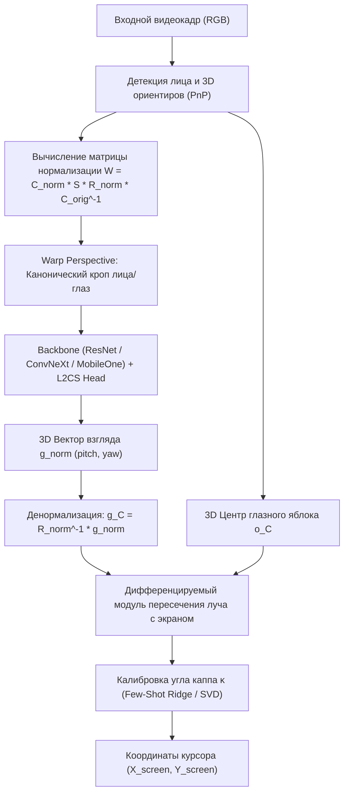
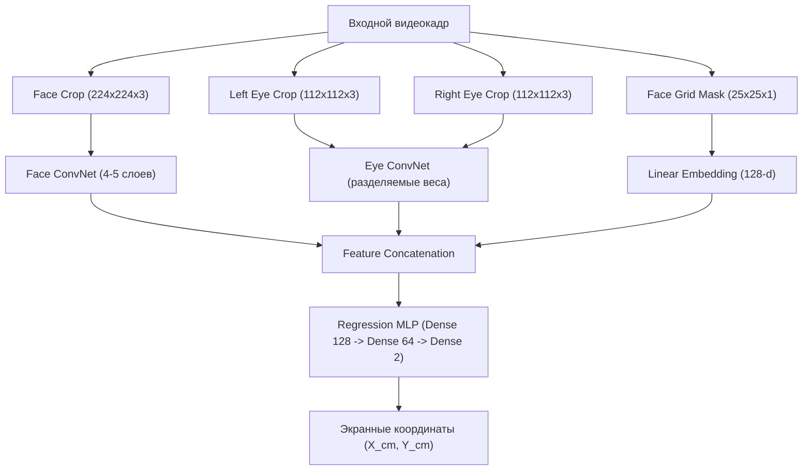
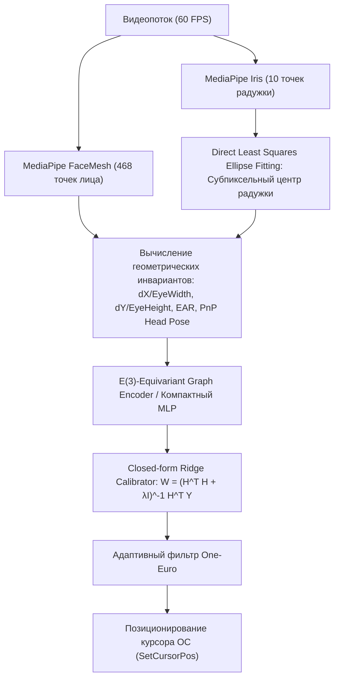
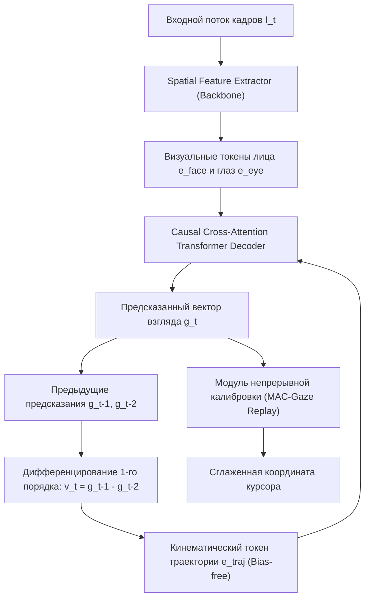
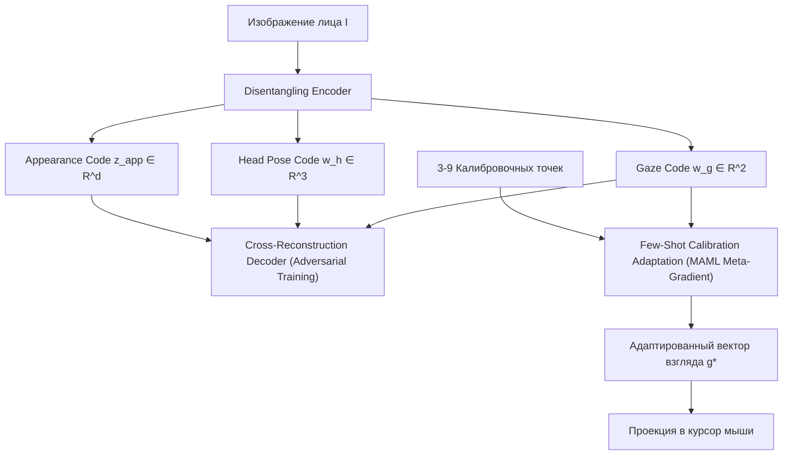
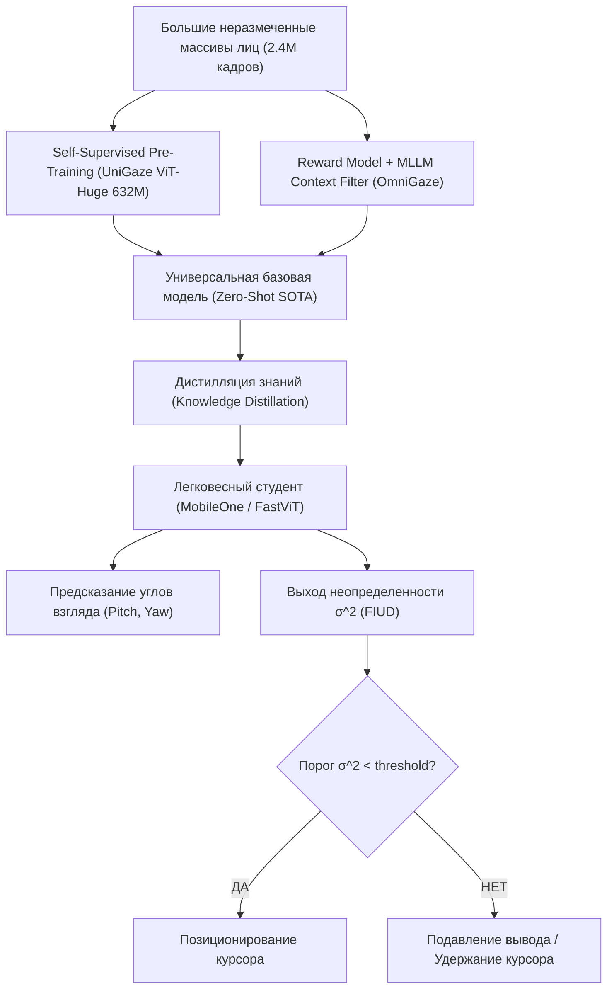
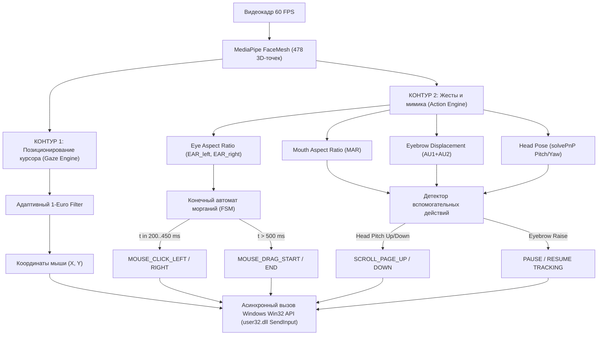

# Архитектурные направления построения моделей позиционирования курсора и управления интерфейсом по движениям глаз, зрачков и мимическим жестам лица

---

## 1. Введение и математическая декомпозиция задачи

Задача бесконтактного управления графическим интерфейсом операционной системы (GUI) на основе видеопотока монокулярной камеры видимого диапазона формулируется как одновременное решение двух задач:
1. Непрерывная оценка двумерных координат точки фиксации взгляда на экране (Point-of-Gaze, PoG): $\mathbf{s}_t = (x_t, y_t)^T \in [0, W_{screen}] \times [0, H_{screen}]$ в пиксельной системе координат дисплея (Pixel Coordinate System, PCS).
2. Дискретная классификация управляющих интерфейсных команд (событий клика, удержания, контекстного меню, прокрутки): $e_t \in \mathcal{E} = \{\text{NONE}, \text{CLICK\_LEFT}, \text{CLICK\_RIGHT}, \text{DOUBLE\_CLICK}, \text{DRAG}, \text{SCROLL\_UP}, \text{SCROLL\_DOWN}\}$.

В системе задействованы четыре базовые декартовы системы координат:
* **Система координат камеры (Camera Coordinate System, CCS):** начало $O_C = (0, 0, 0)^T$ расположено в оптическом центре сенсора камеры. Ось $Z_C$ совпадает с оптической осью и направлена вперед в пространство сцены. Ось $X_C$ направлена вправо вдоль матрицы, ось $Y_C$ направлена вниз.
* **Система координат лица/глаза (Face/Eye Coordinate System, FCS/ECS):** начало $O_F$ зафиксировано в анатомическом центре лица (середина между внутренними углами глаз) или в центрах роговиц глаз $O_E$. Базис повернут относительно CCS на матрицу поворота головы $R_{head} \in SO(3)$.
* **Система координат экрана (Screen Coordinate System, SCS):** начало $O_S$ расположено в левом верхнем углу активной матрицы дисплея. Ось $X_S$ направлена горизонтально вправо (мм), ось $Y_S$ направлена вертикально вниз (мм), ось $Z_S$ ортогональна плоскости матрицы и направлена в сторону пользователя.
* **Пиксельная система координат экрана (PCS):** дискретная матрица пикселей $(u_s, v_s) \in \mathbb{N}^2$, связанная с SCS через физический шаг пикселя $\delta_x = \frac{W_{mm}}{W_{px}}$, $\delta_y = \frac{H_{mm}}{H_{px}}$ (мм/пиксель).

### Метрологический расчет предельной физической точности
Пусть пользователь взаимодействует с OLED-экраном диагональю $14.0''$ ($355.6\text{ мм}$), разрешение $2880 \times 1800$ пикселей, шаг пикселя $\delta = 0.10472\text{ мм/px}$ ($242.5\text{ PPI}$), дистанция до экрана $D = 600\text{ мм}$. Целевой элемент интерфейса — стандартная иконка панели задач размером $82 \times 80\text{ px}$ ($8.59 \times 8.38\text{ мм}$, радиус $R_{icon} = 4.29\text{ мм}$).

Для вероятности устойчивого попадания в иконку $P \ge 0.80$ при Рэлеевском распределении радиальной ошибки $r = \sqrt{\Delta x^2 + \Delta y^2}$:
$$P(r \le R_{icon}) = 1 - \exp\left(-\frac{R_{icon}^2}{2\sigma^2}\right) \ge 0.80 \implies \sigma \le \frac{R_{icon}}{\sqrt{-2\ln(0.20)}} = \frac{4.2935}{1.7941} = 2.393\text{ мм}.$$
Средняя евклидова ошибка системы:
$$\mu_{error} = \sigma \sqrt{\frac{\pi}{2}} = 2.393 \cdot 1.2533 = \mathbf{3.00\text{ мм}} \quad (\mathbf{28.6\text{ px}}).$$
В угловых координатах допустимая ошибка составляет:
$$\mathcal{E}_{ang} \le \arctan\left(\frac{3.00\text{ мм}}{600\text{ мм}}\right) = 0.00500\text{ rad} = \mathbf{0.286^\circ}.$$

На сенсоре стандартной веб-камеры ($720\text{p}$, $HFOV = 60^\circ$, $f_{px} \approx 1108.5\text{ px}$) поворот глазного яблока радиусом $R_{eye} \approx 12.0\text{ мм}$ на целевой угол $0.286^\circ$ вызывает физический сдвиг контура радужки в пространстве:
$$\Delta s_{iris} = 12.0 \cdot \sin(0.286^\circ) = 0.0599\text{ мм} = 59.9\,\mu\text{m}.$$
На матрице камеры этот сдвиг соответствует смещению:
$$\Delta p_{cam} = \frac{\Delta s_{iris}}{\Delta_{world}} = \frac{0.0599\text{ мм}}{0.541\text{ мм/px}} = \mathbf{0.111\text{ пикселя}}.$$
Любая архитектура, претендующая на позиционирование курсора мыши в целевые элементы GUI без вторичных доводчиков, обязана разрешать эквивалент субпиксельного смещения $\le 0.11\text{ px}$ на сенсоре камеры либо задействовать оптику с увеличенным фокусным расстоянием (телеобъективы).

---

## 2. Направление 1: Геометрический 3D-пайплайн (Appearance-based 3D Gaze Vector + Ray-Plane Projection + Регуляризованная калибровка)

### Аннотация подхода
Подход основан на строгой геометрической декомпозиции задачи на физические независимые подсистемы: оценку трехмерной позы головы, нормализацию ракурса изображения лица, извлечение единичного трехмерного вектора взгляда в системе координат лица/камеры и последующее аналитическое проецирование луча на плоскость экрана с учетом взаимного расположения сенсора и монитора.

Входной кадр проходит через детектор лица и оценщик позы (Perspective-n-Point по антропометрической 3D-модели лица). На основе матрицы поворота головы $R_{head}$ и вектора трансляции $\mathbf{t}_{head}$ вычисляется матрица перспективного преобразования (Perspective Warp), которая приводит изображение к канонической виртуальной камере, расположенной на фиксированном расстоянии $d_{norm}$ (обычно $600\text{ мм}$) с нулевым креном (roll = 0). Нормализованный кроп подается в сверточную или трансформерную нейросеть, которая предсказывает сферические углы (pitch $\theta$, yaw $\phi$) или декартов единичный вектор $\mathbf{g}_{norm} \in \mathbb{S}^2$.

Вектор взгляда денормализуется обратным вращением виртуальной камеры $\mathbf{g}_C = R_{norm}^{-1} \mathbf{g}_{norm}$. Далее луч взгляда $\mathbf{p}(\lambda) = \mathbf{o}_C + \lambda \mathbf{g}_C$, исходящий из расчетного 3D-центра глазного яблока $\mathbf{o}_C$, пересекается с плоскостью экрана, параметризованной нормалью $\mathbf{n}_C$ и точкой начала координат дисплея $\mathbf{t}_{CS}$ в системе координат камеры.

Для ликвидации индивидуального систематического смещения (угол каппа $\boldsymbol{\kappa}$, описывающий анатомическое несовпадение оптической и зрительной осей глаза) вводится калибровочный блок. Современная вариация подхода (Cheng et al., CVPR 2025) заменяет фиксированную калибровку дифференцируемым модулем проекции, где параметры ориентации экрана ($\mathbf{r}, \mathbf{t}$) и угол $\boldsymbol{\kappa}$ оптимизируются градиентным спуском по нескольким точкам фиксации.

### Математический аппарат
1. **Матрица пространственной нормализации (Perspective Warp Matrix, Zhang et al.):**
   $$W = C_{norm} S R_{norm} C_{orig}^{-1},$$
   где $C_{orig}$ — калиброванная матрица внутренних параметров камеры:
   $$C_{orig} = \begin{bmatrix} f_x & 0 & c_x \\ 0 & f_y & c_y \\ 0 & 0 & 1 \end{bmatrix}, \quad C_{norm} = \begin{bmatrix} f_{norm} & 0 & w_{norm}/2 \\ 0 & f_{norm} & h_{norm}/2 \\ 0 & 0 & 1 \end{bmatrix},$$
   $$S = \operatorname{diag}\left(1, 1, \frac{d_{norm}}{\|\mathbf{o}_C\|_2}\right), \quad R_{norm} = [\mathbf{r}_x, \mathbf{r}_y, \mathbf{r}_z]^T,$$
   $$\mathbf{r}_z = \frac{\mathbf{o}_C}{\|\mathbf{o}_C\|_2}, \quad \mathbf{r}_x = \frac{\mathbf{h}_x \times \mathbf{r}_z}{\|\mathbf{h}_x \times \mathbf{r}_z\|_2}, \quad \mathbf{r}_y = \mathbf{r}_z \times \mathbf{r}_x,$$
   где $\mathbf{h}_x$ — вектор горизонтальной оси головы из матрицы $R_{head}$.

2. **Функция потерь L2CS-Net (Classification + Continuous Expectation Regression):**
   Диапазон углов разбивается на $K$ бинов шириной $\Delta$ с центрами $c_k$. Сеть выдает логиты $z_k$. Вероятности Softmax:
   $$p_k = \frac{\exp(z_k)}{\sum_{j=1}^K \exp(z_j)}, \quad \hat{y} = \sum_{k=1}^K p_k c_k,$$
   $$\mathcal{L}_{total} = \mathcal{L}_{CE}(y_{bin}, \mathbf{p}) + \beta \cdot \|\hat{y} - y_{continuous}\|_2^2.$$

3. **Пересечение луча с плоскостью экрана в $SE(3)$ (Cheng et al., CVPR 2025):**
   Положение дисплея относительно камеры: вектор вращения Родрига $\mathbf{r} \in \mathbb{R}^3$, угол $\theta_r = \|\mathbf{r}\|_2$, кососимметричная матрица $[\mathbf{r}]_\times$:
   $$R = I + \sin(\theta_r)\frac{[\mathbf{r}]_\times}{\theta_r} + (1 - \cos(\theta_r))\frac{[\mathbf{r}]_\times^2}{\theta_r^2} \in SO(3), \quad \mathbf{n} = R[:, 2].$$
   Точка пересечения в CCS:
   $$\mathbf{p}_{3D} = \mathbf{o}_C + \frac{(\mathbf{t} - \mathbf{o}_C) \cdot \mathbf{n}}{\mathbf{g}_C \cdot \mathbf{n}} \mathbf{g}_C.$$
   Переход в экранные пиксели:
   $$\mathbf{p}_{screen} = R^T (\mathbf{p}_{3D} - \mathbf{t}), \quad u = p_x \cdot \frac{PPI_x}{25.4}, \quad v = p_y \cdot \frac{PPI_y}{25.4}.$$

### Плюсы и минусы
* **Плюсы:**
  * Инвариантность к геометрии дисплея: модель предсказывает физический вектор $\mathbf{g} \in \mathbb{S}^2$, независимый от размера диагонали, PPI и соотношения сторон экрана.
  * Инвариантность к дистанции и положению пользователя за счет жесткого приведения изображения к канонической виртуальной плоскости через $W$.
  * Высокая обобщающая способность: предобученная на публичных датасетах модель (ETH-XGaze, MPIIFaceGaze) переносится на новые мониторы без изменения весов нейросети.
* **Минусы:**
  * Накладные расходы на предобработку: вычисление $W$ и проективная деформация `cv2.warpPerspective` на CPU занимают $4-7\text{ мс}$ на кадр.
  * Чувствительность к ошибкам решения PnP: погрешность локализации опорных точек лица вносит ошибку в матрицу $R_{norm}$, что мультипликативно искажает вектор взгляда.
  * Требование явной калибровки камеры: без матриц внутренних параметров $K$ и дисторсии $D$ модель теряет точность проецирования луча.

### Фундаментальные требования и ограничения
* Знание точной матрицы внутренних параметров камеры $C_{orig}$ (фокусные расстояния $f_x, f_y$, главная точка $c_x, c_y$) и коэффициентов дисторсии Брауна-Конради ($k_1, k_2, p_1, p_2$).
* Знание матрицы внешних параметров взаимного расположения сенсора и экрана $[R_{CS} \mid \mathbf{t}_{CS}] \in SE(3)$ либо наличие калибровочной процедуры для их оптимизации.
* Ограничение: при приближении угла падения луча взгляда к касательной плоскости экрана ($\mathbf{g}_C \cdot \mathbf{n} \to 0$) знаменатель формулы пересечения стремится к нулю, вызывая сингулярность и улет координат курсора в бесконечность.

### Исследования и продукты
* **Исследования:**
  * Zhang et al., "ETH-XGaze: A Large Scale Dataset under Extreme Head Pose and Gaze Variation", ECCV 2020. [arXiv:2007.15837](https://arxiv.org/abs/2007.15837).
  * Abdelrahman et al., "L2CS-Net: Fine-Grained Gaze Estimation in Unconstrained Environments", BMVC 2022. [arXiv:2203.03339](https://arxiv.org/abs/2203.03339).
  * Cheng et al., "3D Prior is All You Need: Cross-Task Few-shot 2D Gaze Estimation", CVPR 2025. [arXiv:2502.04074](https://arxiv.org/abs/2502.04074).
  * Zhang et al., "Revisiting Data Normalization for Appearance-Based Gaze Estimation", ETRA 2018. DOI: 10.1145/3204493.3204588.
* **Продукты и кодовые базы:**
  * OpenFace 2.0 (исследовательский пакет CMU).
  * pytorch_mpiigaze (эталонная имплементация нормализации).
  * Tobii Eye Tracking Core SDK (аппаратный уровень использует сходную параметризацию луча).
  * yakhyo/gaze-estimation (ONNX-конвейер MobileOne).

### Детальная спецификация датасета

#### 1. Структура и состав данных
Датасет должен содержать следующие синхронизированные потоки данных на каждый кадр:
* **Сырое изображение лица**: формат RGB или YUV420, разрешение не ниже $1920 \times 1080$ (оптимально $3840 \times 2160$), сжатие без потерь (Lossless PNG) либо H.264/HEVC с постоянным квантованием (CRF $\le 15$).
* **Матрица внутренних параметров сенсора**: $K \in \mathbb{R}^{3 \times 3}$ и вектор дисторсии $D = [k_1, k_2, p_1, p_2, k_3]$, полученные калибровкой по ChArUco-борду с ошибкой репроекции $\mathcal{E}_{repr} \le 0.15\text{ px}$.
* **Матрица внешних параметров экрана**: $[R_{CS} \mid \mathbf{t}_{CS}] \in SE(3)$ с погрешностью линейного позиционирования $\le 1.0\text{ мм}$ и углового позиционирования $\le 0.5^\circ$.
* **3D-ориентиры лица**: координаты 68 или 468 опорных точек в миллиметрах в системе координат камеры, полученные методом PnP-сопоставления с 3DMM-моделью лица (Basel Face Model).
* **3D-координаты центров глазных яблок**: $\mathbf{o}_{left}, \mathbf{o}_{right} \in \mathbb{R}^3$ в CCS.
* **Ground-Truth вектор взгляда**: $\mathbf{g} = [g_x, g_y, g_z]^T \in \mathbb{R}^3$, $\|\mathbf{g}\|_2 = 1$ в CCS и нормализованный вектор $\mathbf{g}_{norm}$ в системе координат виртуальной камеры.
* **Ground-Truth экранные координаты**: $(X_s, Y_s)$ в миллиметрах и $(u_s, v_s)$ в пикселях.
* **Калибровочный блок**: для каждого субъекта записывается калибровочная сессия из 9 стандартных точек фиксации, равномерно распределенных по периметру и центру экрана.

#### 2. Качественные требования
* **Освещенность**: диапазон освещенности лица должен варьироваться от $150\text{ лк}$ до $850\text{ лк}$. Запрещены локальные засветы (переэкспозиция склеры и радужки, когда пиксели насыщаются до значения 255), так как это уничтожает градиент лимба. Требуется баланс источников: верхнее рассеянное освещение, фронтальный свет от экрана и боковой свет для создания естественных теней.
* **Правила аугментаций**:
  * Случайный геометрический кроп лица и произвольные аффинные трансформации в исходном пространстве кадра **строго запрещены**, поскольку они нарушают матричное соответствие $W = C_{norm} S R_{norm} C_{orig}^{-1}$.
  * Аугментации выполняются строго в *каноническом нормализованном пространстве* виртуальной камеры ($224 \times 224$).
  * Горизонтальный флип (Horizontal Flip) требует согласованного преобразования меток: $g_{norm, x} \to -g_{norm, x}$, $yaw \to -yaw$, матрица $R_{norm}$ инвертируется по оси X.
  * Допустимые фотометрические аугментации: Color Jitter (яркость $\pm 20\%$, контрастность $\pm 20\%$, оттенок $\pm 5\%$), гауссов шум ($\sigma \in [0, 8]$ уровней серого), размытие по Гауссу с ядром $3 \times 3$.
* **Выборка участников и анатомия**:
  * Не менее 80–110 уникальных участников (в ETH-XGaze: 110 человек).
  * Половозрастной состав: $50\%$ мужчин, $50\%$ женщин; возраст от 18 до 65 лет.
  * Разнообразие анатомии глаз: не менее $25\%$ участников азиатского происхождения (с наличием эпикантуса и узкой глазной щелью), участники с разным пигментом радужки (от светло-голубой до темно-коричневой).
  * Окклюзии: не менее $30\%$ участников в корригирующих очках с диоптриями (с антибликовым покрытием и без него), что создает блики на линзах.
* **Пространственное покрытие позы головы и взгляда**:
  * Диапазон позы головы: Head Yaw $\in [-60^\circ, +60^\circ]$, Head Pitch $\in [-35^\circ, +35^\circ]$, Head Roll $\in [-20^\circ, +20^\circ]$.
  * Диапазон направления взгляда: Gaze Yaw $\in [-50^\circ, +50^\circ]$, Gaze Pitch $\in [-40^\circ, +40^\circ]$.
  * Распределение точек взгляда по сфере должно быть квазиравномерным (сетка Фибоначчи на сфере или регулярная сетка с шагом не более $5^\circ$).

#### 3. Количественный объем датасета
* **Общее число кадров**: от $750\,000$ до $1\,200\,000$ валидных изображений.
* **Кадров на одного участника**: $8\,000 - 12\,000$ кадров, записанных в различных положениях головы.
* **Число сессий на участника**: минимум 2 независимые сессии в разные дни с изменением посадки перед монитором.
* **Объем дискового хранилища**: в формате несжатых изображений $1080\text{p}$ — около $1.5\text{ ТБ}$; в нормализованном упакованном виде (HDF5 контейнеры с кропами $224 \times 224$ float16/uint8) — **$65 - 95\text{ ГБ}$**.

---

## 3. Направление 2: Прямая сквозная регрессия в координаты экрана (Direct End-to-End Screen Point-of-Gaze Regression)

### Аннотация подхода
Направление исключает промежуточные физические сущности (позу головы, 3D-векторы направления взгляда и геометрические уравнения плоскостей), формулируя задачу как прямую сквозную нелинейную регрессию из растровых изображений в экранные пиксели или сантиметры.

Архитектура принимает на вход композитный тензор, состоящий из вырезанного патча полного лица, патчей левого и правого глаза высокого разрешения, а также явного пространственного дескриптора положения лица на исходном кадре (Face Grid). Face Grid представляет собой бинарную сетку низкого разрешения (обычно $25 \times 25$), где ячейки, покрытые ограничивающим прямоугольником лица, заполняются единицами, что кодирует масштаб лица и его трансляцию в поле зрения камеры.

Каждый информационный поток обрабатывается собственной сверточной ветвью. Признаковые карты на выходе сверток сжимаются полносвязными слоями, конкатенируются в единый вектор скрытого состояния и передаются в финальный регрессор (MLP из 2–3 слоев), на выходе которого формируются координаты $(x_s, y_s) \in \mathbb{R}^2$. Обучение выполняется по сквозной функции потерь Евклидова расстояния на экране.

Поскольку модель оптимизируется напрямую под минимизацию экранной ошибки, она не накапливает погрешности промежуточных этапов (ошибок PnP или калибровки камеры), однако выучивает скрытые корреляции конкретного устройства, на котором производился сбор обучающих данных.

### Математический аппарат
1. **Пространственный дескриптор Face Grid (Krafka et al.):**
   Исходный кадр размера $W \times H$ дискретизируется на сетку $G_w \times G_h$ ($25 \times 25$). Пусть ограничивающий прямоугольник лица задан координатами $[x_{min}, y_{min}, w_{face}, h_{face}]$. Значение ячейки $(i, j) \in [0, G_w-1] \times [0, G_h-1]$:
   $$F_{grid}(i, j) = \begin{cases} 1, & \text{если } \left[\frac{i W}{G_w}, \frac{(i+1) W}{G_w}\right] \times \left[\frac{j H}{G_h}, \frac{(j+1) H}{G_h}\right] \cap \text{BBox}_{face} \ne \emptyset \\ 0, & \text{иначе} \end{cases}$$

2. **Сквозная функция потерь на плоскости дисплея:**
   $$\mathcal{L}_{screen} = \frac{1}{N} \sum_{i=1}^N \sqrt{(x_{pred, i} - x_{gt, i})^2 + (y_{pred, i} - y_{gt, i})^2} + \lambda \|\mathbf{w}\|_2^2.$$

3. **Адаптивная регрессия площади фиксации (AFF-Net, Adaptive Feature Fusion):**
   Признаки глаз $F_{eyes}$ и лица $F_{face}$ объединяются через обучаемый механизм динамического взвешивания:
   $$w_{eyes} = \sigma(W_e F_{eyes} + b_e), \quad w_{face} = \sigma(W_f F_{face} + b_f),$$
   $$F_{fused} = [w_{eyes} \odot F_{eyes} \,\|\, w_{face} \odot F_{face} \,\|\, F_{grid}].$$

### Плюсы и минусы
* **Плюсы:**
  * Отсутствие необходимости во внутренней калибровке камеры (не требуется расчет матриц $K$ и дисторсии).
  * Отсутствие необходимости в калибровке взаимного расположения камеры и экрана: взаимный сдвиг выучивается сетью неявно.
  * Устойчивость к локальным срывам детектора ключевых точек лица: сеть обучается на сырых растрах без явных ландмарок.
* **Минусы:**
  * Отсутствие переносимости между устройствами (Device-dependent): модель, обученная на конкретном типе ноутбука, выдает систематический сдвиг при запуске на дисплее с другой диагональю или иным положением камеры.
  * Чувствительность к изменению дистанции: смещение пользователя на $15\text{ см}$ вперед/назад меняет масштаб лица нелинейно, вызывая радиальную деформацию предсказываемых координат.
  * Высокая вычислительная сложность: параллельная обработка трех растровых потоков (лицо, два глаза) требует больших затрат памяти.

### Фундаментальные требования и ограничения
* Обучающая выборка обязана собираться либо на том же типе оборудования, где будет развернута модель, либо охватывать сотни конфигураций устройств с явной подачей метаданных экрана (размеры в мм, PPI).
* Ограничение: невозможность экстраполяции координат за пределы активной матрицы дисплея, на которой обучалась сеть.

### Исследования и продукты
* **Исследования:**
  * Krafka et al., "Eye Tracking for Everyone", CVPR 2016. DOI: 10.1109/CVPR.2016.239.
  * Bao et al., "Adaptive Feature Fusion Network for Gaze Estimation in the Wild", IEEE TIP 2021.
* **Продукты и кодовые базы:**
  * CSAIL Vision iTracker.
  * WebGazer.js (режим браузерной регрессии по кликам).
  * Pupil Labs Core (2D surface marker mode).

### Детальная спецификация датасета

#### 1. Структура и состав данных
* **Изображение лица**: кроп $224 \times 224 \times 3$, центрированный по Bounding Box детектора лица с запасом $15\%$.
* **Изображения глаз**: отдельные кропы левого и правого глаза размером $112 \times 112 \times 3$ или $224 \times 224 \times 3$.
* **Face Grid вектор**: бинарный тензор $1 \times 25 \times 25$ с разметкой ячеек присутствия лица.
* **Метаданные экрана**: физическая ширина $W_{mm}$ и высота $H_{mm}$ матрицы, разрешение в пикселях $W_{px}, H_{px}$, плотность PPI, 2D-координаты расположения оптического глазка камеры относительно верхнего левого угла матрицы экрана $(X_{cam\_mm}, Y_{cam\_mm})$.
* **Ориентация устройства**: дискретный флаг (Portrait, Landscape Left, Landscape Right).
* **Ground-Truth метки**: непрерывные координаты фиксации $(x_s, y_s)$ в сантиметрах относительно камеры и в пикселях относительно экрана.

#### 2. Качественные требования
* **Освещенность**: In-the-wild режим с экстремальным разбросом от $10\text{ лк}$ (темная комната, где лицо освещено только экраном) до $1200\text{ лк}$ (солнечный свет из окна).
* **Правила аугментаций**:
  * Горизонтальный флип допустим **только при одновременной математической инверсии**: $x_{screen} \to W_{screen\_cm} - x_{screen}$, инверсия сетки Face Grid по горизонтали $F_{grid}[i, j] \to F_{grid}[G_w - 1 - i, j]$, и взаимная перестановка местами кропов левого и правого глаза ($I_{left} \leftrightarrow I_{right}$).
  * Случайное масштабирование и случайный сдвиг Bounding Box лица (Jittering $\pm 5\%$) для обучения инвариантности к неточностям детектора лица.
  * Изменение цветовой температуры дисплея (имитация ночного режима Night Light / TrueTone с преобладанием желтого спектра).
* **Выборка участников**:
  * Не менее $1\,200 - 1\,500$ уникальных человек (в датасете GazeCapture задействовано 1474 участника).
  * Разнообразие устройств: сбор должен производиться минимум на $40 - 60$ различных моделях ноутбуков, планшетов и смартфонов с диагоналями от $5.5''$ до $27''$.
* **Поведение пользователя**:
  * Свободное удержание устройства в руках либо естественная работа за столом. Дистанция $D \in [250, 700]\text{ мм}$.

#### 3. Количественный объем датасета
* **Общее число кадров**: от $2\,000\,000$ до $2\,500\,000$ сэмплов (размер GazeCapture: 2.45M кадров).
* **Кадров на одного участника**: $1\,500 - 2\,000$ кадров в сессиях длительностью по 3–5 минут.
* **Объем дискового хранилища**: в упакованном формате с предрассчитанными Face Grid и сжатыми JPEG-кропами — **$120 - 160\text{ ГБ}$** (исходные несжатые видеомассивы требуют $> 400\text{ ГБ}$).

---

## 4. Направление 3: Легковесные геометрические модели на ключевых точках лица и контура радужки (Landmark-based / Feature-based Geometry + Regression / Graph Neural Networks)

### Аннотация подхода
Направление полностью отказывается от подачи тяжелых растровых изображений в финальный регрессор взгляда, разделяя пайплайн на стандартизированный геометрический фронтенд и компактный математический бэкенд.

Фронтенд представляет собой высокооптимизированную нейросеть локализации ключевых точек лица (MediaPipe FaceMesh с расширением Iris, 478 3D-ориентиров). Из них 468 точек описывают каркас черепа и мягкие ткани лица, а 10 точек (по 5 на каждый глаз) локализуют субпиксельный центр зрачка и контур радужки. По ключевым точкам контура радужки методом наименьших квадратов вписывается эллипс, дающий центр зрачка $\mathbf{c}_{iris} = (u, v)$ с субпиксельной дисперсией $\sigma \le 0.08\text{ px}$. Физическая константа диаметра роговицы взрослого человека ($D_{iris} = 11.7 \pm 0.5\text{ мм}$) используется как масштабный базис для восстановления метрической глубины $Z$ без дальномера.

Из полученного набора 3D-ориентиров формируется компактный вектор геометрических дескрипторов $X \in \mathbb{R}^d$ ($d \in [16, 161]$): относительные смещения радужки относительно уголков глазной щели (внутреннего и внешнего кантуса), степень раскрытия век (Eye Aspect Ratio), углы ориентации головы (yaw, pitch, roll из решения PnP).

Вектор дескрипторов подается в сверхлегковесный регрессор: 3-слойный перцептрон (MLP), градиентный бустинг решающих деревьев (CatBoost / LightGBM) или эквивариантную графовую нейронную сеть (EMC-Gaze $E(3)$-equivariant graph encoder). Калибровка под конкретного пользователя осуществляется аналитическим решением гребневой регрессии (Closed-form Ridge Regression) по 5–9 точкам.

### Математический аппарат
1. **Геометрические нормализованные дескрипторы смещения радужки:**
   Пусть $\mathbf{p}_{iris}$ — декартовы координаты центра радужки, $\mathbf{p}_{inner}$ — внутренний уголок глазной щели, $\mathbf{p}_{outer}$ — внешний уголок, $\mathbf{p}_{top}$ — верхнее веко, $\mathbf{p}_{bottom}$ — нижнее веко:
   $$d_x = \frac{(\mathbf{p}_{iris} - \mathbf{p}_{inner}) \cdot (\mathbf{p}_{outer} - \mathbf{p}_{inner})}{\|\mathbf{p}_{outer} - \mathbf{p}_{inner}\|_2^2},$$
   $$d_y = \frac{(\mathbf{p}_{iris} - \mathbf{p}_{bottom}) \cdot (\mathbf{p}_{top} - \mathbf{p}_{bottom})}{\|\mathbf{p}_{top} - \mathbf{p}_{bottom}\|_2^2}.$$

2. **Метрическая глубина лица по константе роговицы:**
   $$Z_{metric} = \frac{f_x \cdot D_{iris\_true}}{d_{iris\_pixels}} = \frac{f_x \cdot 11.7\text{ мм}}{\|\mathbf{p}_{iris\_left\_edge} - \mathbf{p}_{iris\_right\_edge}\|_2}.$$

3. **Замкнутый гребневой мета-калибратор (EMC-Gaze, arXiv:2603.12388):**
   Пусть $\mathbf{H} = [\mathbf{E}_{calib}, \mathbf{1}] \in \mathbb{R}^{K \times (d+1)}$ — матрица эмбеддингов $K$ калибровочных сэмплов, полученных с графового энкодера, $\mathbf{Y} \in \mathbb{R}^{K \times 2}$ — ground-truth экранные координаты. Оптимальные калибровочные веса вычисляются аналитически:
   $$\mathbf{W}^* = (\mathbf{H}^T \mathbf{H} + \lambda \mathbf{I})^{-1} \mathbf{H}^T \mathbf{Y}.$$
   Предсказание для произвольного нового кадра с эмбеддингом $\mathbf{e}$:
   $$\hat{\mathbf{y}} = [\mathbf{e}, 1] \mathbf{W}^*.$$
   Вся графовая сеть обучается дифференцированием функции потерь через аналитическое решение гребневой регрессии:
   $$\frac{\partial \mathcal{L}}{\partial \mathbf{H}} = \frac{\partial \mathcal{L}}{\partial \mathbf{W}^*} \frac{\partial \mathbf{W}^*}{\partial \mathbf{H}}.$$

### Плюсы и минусы
* **Плюсы:**
  * Экстремально низкая вычислительная сложность: этап регрессии требует $\le 0.02\text{ GFLOPs}$, размер модели ONNX составляет всего $4.76\text{ МБ}$ (EMC-Gaze).
  * Высокая скорость инференса: суммарное время конвейера на бюджетном CPU составляет $8-12\text{ мс}$, что гарантирует стабильные $\ge 60\text{ FPS}$ в браузере (через WebAssembly) или фоновом сервисе Windows.
  * Нулевые требования к дискретному GPU.
  * Высокая точность калибровки в режиме фиксированной головы (Still-head error **$2.92^\circ$** у EMC-Gaze после 9 точек калибровки).
* **Минусы:**
  * Потеря текстурной информации: модель слепа к текстуре склеры, микрокапиллярам и градиентам лимба, опираясь только на дискретные координаты ориентиров.
  * Ограничение точности фронтенда: высокочастотный джиттер (дрожание) ландмарок MediaPipe ($0.5-1.5\text{ px}$) порождает дрожание курсора с амплитудой до $15-30\text{ px}$ на экране, требуя сильной фильтрации (One-Euro Filter).
  * Деградация при динамических поворотах головы: ошибка EMC-Gaze возрастает с $2.92^\circ$ до **$5.79^\circ$** при свободных движениях головы из-за нелинейных деформаций лицевой сетки.

### Фундаментальные требования и ограничения
* Обязательное наличие стабильного освещения лица: при падении освещенности ниже 20 люкс детектор MediaPipe Iris теряет границы радужки, приводя к замиранию или хаотическим скачкам курсора.
* Ограничение: разрешение сенсора камеры должно обеспечивать видимый диаметр радужки не менее $20\text{ px}$ (на дистанции $600\text{ мм}$ минимальное разрешение сенсора — $1280 \times 720$).

### Исследования и продукты
* **Исследования:**
  * Zhang, Chenkai, "Deployment-Oriented Session-wise Meta-Calibration for Landmark-Based Webcam Gaze Tracking" (EMC-Gaze), arXiv:2603.12388, March 2026.
  * Ablavatski et al., "Real-time Pupil Tracking from Monocular Video for Digital Screens", Google Research, 2020.
  * Soukupová & Čech, "Real-Time Eye Blink Detection using Facial Landmarks", CVWW 2016.
* **Продукты и кодовые базы:**
  * Google Project Euphonia / Look to Speak.
  * NativeSensors/EyeGestures.
  * WebGazer.js (FaceMesh backend).
  * OptiKey.

### Детальная спецификация датасета

#### 1. Структура и состав данных
* **Массив числовых координат 3D-ориентиров**: тензор размера $N \times 478 \times 3$ (где 468 точек — каркас лица FaceMesh, 10 точек — контуры радужки Iris), нормализованный в интервал $[0, 1]$ относительно ширины и высоты кадра с сохранением Z-координаты.
* **Субпиксельные параметры эллипсов радужек**: центры $(u_c, v_c)$, длины полуосей $(a, b)$, угол наклона $\theta_{ellipse}$ для обоих глаз.
* **Вектор позы головы**: углы Эйлера (Pitch, Yaw, Roll) и вектор трансляции $\mathbf{t}$, полученные решением PnP.
* **Оценка достоверности (Confidence scores)**: вероятность детекции лица и скоры видимости для каждого ключевого ориентира.
* **Метки фиксации экрана**: точные 2D координаты $(x_s, y_s)$ в пикселях и миллиметрах.
* **Калибровочный заголовок сессии**: сэмплы ровно 9 калибровочных точек, зафиксированных перед началом сессии.

#### 2. Качественные требования
* **Освещенность**: рассеянный мягкий свет от $250$ до $600\text{ лк}$. Запрещен узконаправленный верхний свет, отбрасывающий глубокие тени от бровей в глазницы (это приводит к смещению детектируемого центра зрачка вниз на $1.5 - 3.0\text{ px}$).
* **Аугментации ориентиров**:
  * Добавление белого гауссова шума непосредственно к 2D/3D координатам ориентиров с дисперсией $\sigma \in [0.1, 0.6]\text{ px}$ для обучения робастности регрессора к аппаратному шуму детектора MediaPipe.
  * Синтетическое масштабирование расстояния между зрачками (Inter-ocular distance, IOD) на $\pm 10\%$ для симуляции антропометрических различий черепа.
  * Случайная генерация микроповоротов головы ($\Delta \theta \in [-3^\circ, +3^\circ]$) с пересчетом проекции ориентиров по матрице Родрига.
* **Выборка участников**:
  * Не менее $40 - 60$ участников с проведением не менее 2 сессий на каждого (в EMC-Gaze использовалось 33 сессии).
  * Обязательное включение людей с различным разрезом глаз (европеоидный, восточноазиатский с закрытым внутренним кантусом), так как форма века определяет границы видимой части радужки.
* **Протокол сбора**:
  * Сессия делится на два обязательных режима:
    1. **Still-Head**: голова зафиксирована на подставке/подголовнике на расстоянии $600\text{ мм}$ или $1000\text{ мм}$, взгляд последовательно обходит точки экрана.
    2. **Dynamic-Head**: пользователь плавно покачивает и поворачивает голову в пределах $\pm 20^\circ$, продолжая удерживать взгляд на движущейся или статичной точке экрана.

#### 3. Количественный объем датасета
* **Число сэмплов**: от $250\,000$ до $500\,000$ векторов ориентиров.
* **Сэмплов на участника**: $4\,000 - 8\,000$ сэмплов (эквивалентно $2-4$ минутам непрерывной записи при 60 FPS).
* **Объем дискового хранилища**: поскольку хранятся только числовые векторы ориентиров (без растровых видеокадров), формат Parquet / HDF5 обеспечивает компактный размер всего **$450 - 850\text{ МБ}$**, что позволяет полностью загружать обучающую выборку в оперативную память (RAM).

---

## 5. Направление 4: Временные дифференциальные и кинематические траекторные архитектуры (Temporal / Differential Gaze Tracking & Trajectory Kinematics)

### Аннотация подхода
Направление устраняет фундаментальный дефект однокадровых моделей (Single-frame models): покадровые предсказания флуктуируют во времени как высокочастотный шум, а кинематика движения глаз (саккады, фиксации, плавное слежение) игнорируется.

Подход базируется на двух концепциях. Первая концепция — **дифференциальная оценка взгляда (Differential Gaze Estimation, Prescott et al., 2026)**. Вместо предсказания абсолютного положения взгляда сеть оценивает относительный сдвиг взгляда между текущим кадром $I_t$ и калибровочными кадрами-якорями $I_{anchor}$, собранными в начале сессии: $\Delta \mathbf{g}_{t, anchor} = \mathcal{G}(I_t, I_{anchor})$. Дифференцирование вычитает межиндивидуальное смещение пользователя (User Bias), а временное окно (контекст длительностью $3.2 - 6.4\text{ с}$) аккумулирует микросаккады и подавляет временной дрейф.

Вторая концепция — **явное моделирование кинематической траектории (EyeTAG, Lee et al., Oct 2026)**. Сеть на каждом шаге дифференцирует собственные предыдущие предсказания, вычисляя вектор угловой скорости первого порядка: $\mathbf{v}_t = \hat{\mathbf{g}}_t - \hat{\mathbf{g}}_{t-1}$. Этот вектор подается обратно в сеть как компактный кинематический токен. Поскольку оператор разности трансляционно инвариантен ($\Delta(\mathbf{g} + \mathbf{b}) = \Delta\mathbf{g}$), кинематический токен полностью очищен от индивидуального анатомического сдвига.

Причинно-следственный трансформер-декодер (Causal Transformer Decoder) связывает визуальные эмбеддинги лица, глаз и кинематический токен с авторегрессионной маской, исключающей заглядывание в будущее. Дополнительно подключаются алгоритмы непрерывной адаптации (MAC-Gaze, Lei et al., May 2025), которые отслеживают смену позы посадки и обновляют профиль калибровки методом Replay-based Continual Learning.

### Математический аппарат
1. **Дифференциальная формулировка с временным окном (Prescott et al., arXiv:2610.11036):**
   Пусть $I_t$ — текущий кадр, $I_{ref}$ — опорный кадр фиксации на известном маркере экрана. Сиамская сеть с весами $\Theta$:
   $$\Delta\mathbf{g}_t = f_\Theta(I_t, I_{ref}), \quad \mathbf{g}_t = \mathbf{g}_{ref} + \Delta\mathbf{g}_t.$$
   Для подавления накопления дрейфа в узком диапазоне экрана вводится аффинная коррекция с ограничением наклона (Slope Clipping):
   $$\hat{\mathbf{g}}_{corr} = \operatorname{clip}(\mathbf{A}, 0.5, 2.0) \cdot \mathbf{g}_t + \mathbf{b}.$$

2. **Кинематический токен траектории первого порядка (EyeTAG, arXiv:2610.00922):**
   Пусть $\hat{\mathbf{g}}_{t-\tau:t-1}$ — последовательность предшествующих предсказаний взгляда длины $\tau$. Вектор приращений:
   $$\Delta\hat{\mathbf{g}}_k = \hat{\mathbf{g}}_k - \hat{\mathbf{g}}_{k-1}, \quad k \in [t-\tau+1, t-1].$$
   Токен кинематики формируется линейной проекцией:
   $$\mathbf{e}_t^{traj} = \text{MLP}(\operatorname{Concat}(\Delta\hat{\mathbf{g}}_{t-\tau+1}, \dots, \Delta\hat{\mathbf{g}}_{t-1})).$$

3. **Кросс-внимание каузального декодера:**
   $$\mathbf{Q} = \mathbf{e}_t^{traj} W_Q, \quad \mathbf{K} = [\mathbf{e}_t^{face}, \mathbf{e}_t^{eye}] W_K, \quad \mathbf{V} = [\mathbf{e}_t^{face}, \mathbf{e}_t^{eye}] W_V,$$
   $$\text{Attention}(\mathbf{Q}, \mathbf{K}, \mathbf{V}) = \operatorname{Softmax}\left(\frac{\mathbf{Q} \mathbf{K}^T}{\sqrt{d_k}} + \mathbf{M}_{causal}\right) \mathbf{V},$$
   где $\mathbf{M}_{causal}(i, j) = -\infty$ при $j > i$.

### Плюсы и минусы
* **Плюсы:**
  * Радикальное подавление высокочастотного дрожания курсора: моделирование кинематики устраняет шум без внесения фазовой задержки (lag), свойственной слепым фильтрам низких частот.
  * Устойчивость к анатомическим различиям пользователей: дифференцирование скорости ликвидирует постоянную составляющую индивидуальной ошибки (User Bias).
  * Лучшие в классе показатели угловой точности в естественных экранных условиях: **$1.598^\circ$** у Differential Gaze (arXiv:2610.11036) и **$2.56^\circ$** у EyeTAG на сложном бенчмарке EVE.
  * Подавление долговременного калибровочного дрейфа (MAC-Gaze снижает ошибку на $31.7\%$ при длительных сессиях).
* **Минусы:**
  * Задержка инициализации конвейера: модели требуется буфер из нескольких предшествующих кадров для старта вычисления кинематики.
  * Ошибка первого шага при резкой саккаде: при внезапном скачке взгляда кинематический токен первого порядка кратковременно выдает запаздывающий импульс скорости.
  * Увеличение расхода памяти на хранение кольцевых буферов кадров и скрытых состояний трансформера.

### Фундаментальные требования и ограничения
* Строго фиксированная частота кадров видеопотока ($60\text{ FPS}$ или $120\text{ FPS}$) с постоянным межкадровым интервалом $\Delta t$. Пропуски кадров (Frame Drops) разрушают расчет производной $\Delta \mathbf{g} / \Delta t$.
* Ограничение: система требует калибровочной точки привязки в начале работы для фиксации абсолютного фазового нуля $\mathbf{g}_{anchor}$.

### Исследования и продукты
* **Исследования:**
  * Prescott et al., "Adapting Appearance-Based Gaze Estimation to Narrow-Range, Long-Duration Screen Viewing", arXiv:2610.11036, Oct 2026.
  * Lee et al., "EyeTAG: Eye Trajectory-Aware Gaze Estimation", arXiv:2610.00922, Oct 2026.
  * Lei et al., "MAC-Gaze: Motion-Aware Continual Calibration for Mobile Gaze Tracking", arXiv:2505.22769, May 2025.
  * Kellnhofer et al., "Gaze360", ICCV 2019; Park et al., "EVE Benchmark", CVPR 2020.
* **Продукты и кодовые базы:**
  * Apple VisionOS Gaze Interaction Pipeline.
  * Tobii Horizon.

### Детальная спецификация датасета

#### 1. Структура и состав данных
* **Непрерывные видеопотоки (Video Sequences)**: запись без покадровых разрывов с частотой $60\text{ FPS}$ или $120\text{ FPS}$. Кодек без межкадровых потерь или intra-only профиль с межкадровым постоянным битрейтом (CBR $\ge 50\text{ Мбит/с}$).
* **Монотонные аппаратные таймстемпы**: метки времени сенсора камеры с джиттером тайминга $\le 0.1\text{ мс}$.
* **Синхронизированный сигнал эталонного айтрекера**: ground-truth поток от инфракрасного айтрекера (EyeLink 1000 Plus или Tobii Pro Fusion) с частотой опроса $500 - 1000\text{ Гц}$, синхронизированный по аппаратному TTL-триггеру (Genlock).
* **Сегментация глазодвигательных событий**:
  * Фиксации (угловая скорость $\|\mathbf{v}\| < 30^\circ/\text{с}$).
  * Саккады (угловая скорость $\|\mathbf{v}\| \ge 300^\circ/\text{с}$, ускорение $\ge 8000^\circ/\text{с}^2$).
  * Плавное слежение (Smooth Pursuit, скорость $10 - 40^\circ/\text{с}$).
  * Постсаккадические микроколебания (Glissades / Microsaccades).
* **Калибровочные якоря (Anchor Frames)**: подмножество кадров, когда пользователь фиксировал взгляд на 9 опорных точках в начале, середине и конце длительной сессии.

#### 2. Качественные требования
* **Освещенность**: моделирование длительных сессий (Long-duration) требует постепенного изменения освещенности (имитация смены дня и ночи, плавное угасание света от $500\text{ лк}$ до $50\text{ лк}$ за 30 минут) для тестирования устойчивости к дрейфу калибровки.
* **Правила аугментаций**:
  * Аугментации обязаны быть **строго временнó-согласованными (Temporal Consistent)** на протяжении всего временного окна ($3.2 - 6.4\text{ секунды}$). Запрещено накладывать независимый покадровый шум, разрушающий расчет производной $\Delta \mathbf{g}$.
  * Допустимо временное масштабирование (Time-Warping): ускорение/замедление воспроизведения последовательности на $\pm 15\%$ с интерполяцией таймстемпов для обучения разным скоростям саккад.
  * Горизонтальный флип требует одновременной инверсии знака кинематического токена скорости: $v_x \to -v_x$.
* **Выборка участников**:
  * Не менее $60 - 80$ участников (в исследовании Prescott et al. использовалось 76 участников и 140 длительных записей; в EVE — 54 участника).
* **Специфика сессий**:
  * Длительность непрерывной записи одной сессии: **не менее 20–45 минут**.
  * Естественные сценарии взаимодействия: чтение научного текста, просмотр динамического видео, решение задач на логику, набор текста на клавиатуре (сопровождающийся периодическими взглядами вниз на клавиши).

#### 3. Количественный объем датасета
* **Общее число кадров**: от $1\,500\,000$ до $3\,000\,000$ кадров (эквивалентно 15–30 часам синхронизированного видео высокого разрешения).
* **Кадров на одного участника**: $25\,000 - 50\,000$ непрерывных кадров.
* **Объем дискового хранилища**: видеопоток в разрешении $1080\text{p}$ при $60\text{ FPS}$ с высоким битрейтом требует около $18\text{ ГБ}$ на один час записи. Суммарный объем сырого архива: **$350 - 650\text{ ГБ}$**.

---

## 6. Направление 5: Архитектуры мета-обучения и латентной дизимпликации (Few-Shot Meta-Learning & Disentangled Latent Spaces)

### Аннотация подхода
Направление нацелено на преодоление барьера персонализации без необходимости длительной ручной калибровки по десяткам экранных точек. Фундаментальный принцип заключается в расщеплении латентного пространства признаков (Disentanglement) на независимые ортогональные подпространства.

Архитектура строится на базе автоэнкодера с разделением представлений (Disentangling Auto-Encoder, FAZE, Park et al.). Входной кадр лица кодируется в три взаимно изолированных вектора:
1. Вектор направления взгляда $\mathbf{w}_g \in \mathbb{R}^2$ (инвариантный к форме лица и позе).
2. Вектор позы головы $\mathbf{w}_h \in \mathbb{R}^3$.
3. Инвариантный код индивидуальности/внешности $\mathbf{z}_{app} \in \mathbb{R}^d$ (кодирует разрез глаз, форму носа, цвет радужки, текстуру кожи).

Обучение дизимпликации контролируется состязательными потерями (Adversarial Loss) и кросс-реконструкцией: декодер обязан восстановить исходное лицо при комбинировании кода внешности человека $A$ с кодом взгляда человека $B$.

Калибровка под нового пользователя организуется через фреймворк мета-обучения (Model-Agnostic Meta-Learning, MAML). Вместо подгонки регрессоров «поверх» нейросети, градиент оптимизирует начальное состояние адаптационных весов $\boldsymbol{\theta}$. При калибровке по $K \in [3, 9]$ точкам веса обновляются за 1–3 шага градиентного спуска: $\boldsymbol{\theta}' = \boldsymbol{\theta} - \alpha \nabla \mathcal{L}_{calib}$.

В современной многозадачной вариации (MAGE, Huang et al., May 2025) архитектура расширяется до одновременного предсказания 6-DoF параметров взгляда в пространстве робототехнического взаимодействия с модулем калибровки Easy-Calibration без использования калибровочной сетки на экране.

### Математический аппарат
1. **Расщепление представлений (Disentangling Loss):**
   Пусть энкодер отображает $I \to (\mathbf{w}_g, \mathbf{w}_h, \mathbf{z}_{app})$, а генератор реконструирует кадр $\hat{I} = \mathcal{G}(\mathbf{w}_g, \mathbf{w}_h, \mathbf{z}_{app})$. Функция потерь включает член реконструкции и взаимную независимость:
   $$\mathcal{L}_{recon} = \|I - \hat{I}\|_1 + \lambda_{VGG} \|\phi(I) - \phi(\hat{I})\|_1,$$
   $$\mathcal{L}_{disentangle} = \mathcal{L}_{recon} + \gamma_{reg} \|\mathbf{z}_{app}\|_2^2 + \mathcal{L}_{adv}.$$

2. **Мета-адаптация весов (MAML Few-Shot Gaze Calibration):**
   Внутренний цикл оптимизации (Inner Loop) на сэмпле калибровки $\mathcal{D}_{task}^{calib} = \{(I_k, \mathbf{g}_{gt, k})\}_{k=1}^K$:
   $$\boldsymbol{\theta}' = \boldsymbol{\theta} - \alpha \nabla_{\boldsymbol{\theta}} \sum_{k=1}^K \mathcal{L}_{task}(\mathcal{M}(I_k; \boldsymbol{\theta}), \mathbf{g}_{gt, k}).$$
   Внешний цикл оптимизации мета-градиента (Outer Loop) по валидационному множеству той же персоны $\mathcal{D}_{task}^{val}$:
   $$\boldsymbol{\theta} \leftarrow \boldsymbol{\theta} - \beta \nabla_{\boldsymbol{\theta}} \sum_{\tau} \mathcal{L}_{task}(\mathcal{M}(\mathcal{D}_\tau^{val}; \boldsymbol{\theta}'_\tau)).$$

3. **Результативность калибровки FAZE на MPIIGaze:**
   * $0$ точек (Zero-shot): угловая ошибка **$4.82^\circ$**.
   * $3$ точки (3-shot): **$3.68^\circ$** (снижение ошибки на $23.6\%$).
   * $9$ точек (9-shot): **$3.18^\circ$** (снижение ошибки на $34.0\%$).

### Плюсы и минусы
* **Плюсы:**
  * Рекордная скорость персонализации: радикальное снижение ошибки достигается всего за 3 точки фиксации взгляда.
  * Подавление межиндивидуальной вариативности: явное удаление кода внешности $\mathbf{z}_{app}$ исключает влияние цвета глаз, макияжа, формы века и возраста на оценку углов.
  * Компактность калибровочного профиля: для сохранения профиля пользователя достаточно сохранить компактный вектор смещения $\Delta \mathbf{z} \in \mathbb{R}^{16}$.
* **Минусы:**
  * Экстремальная сложность обучения: балансировка состязательных, перцептивных и регрессионных лоссов требует длительного подбора гиперпараметров.
  * Высокая вычислительная сложность автоэнкодеров при обучении (сотни эпох на многопроцессорных GPU).
  * На инференсе требуется выполнение обратного распространения ошибки (Backpropagation) на клиентском устройстве во время процедуры калибровки.

### Фундаментальные требования и ограничения
* Клиентский рантайм должен поддерживать вычисление градиентов для выполнения шагов MAML-адаптации весов калибровочного слоя.
* Ограничение: если освещение пользователя во время калибровки радикально отличается от рабочего освещения, код внешности $\mathbf{z}_{app}$ деформируется, снижая точность адаптации.

### Исследования и продукты
* **Исследования:**
  * Park et al., "Few-Shot Adaptive Gaze Estimation" (FAZE), ICCV 2019. [arXiv:1905.01941](https://arxiv.org/abs/1905.01941).
  * Huang et al., "MAGE", arXiv:2505.16384, May 2025.
  * Cheng et al., "PureGaze", AAAI 2022.
* **Продукты и кодовые базы:**
  * NVlabs/few_shot_gaze.
  * MAGE Framework.

### Детальная спецификация датасета

#### 1. Структура и состав данных
* **Эпизодическая структура (Meta-Tasks)**: данные группируются строго по задачам $\mathcal{T}_i = \{\mathcal{S}_i, \mathcal{Q}_i\}$, где:
  * **Support Set ($\mathcal{S}_i$)**: ровно $K \in \{3, 5, 9\}$ пар (изображение канонического лица $224 \times 224$ + истинный вектор взгляда $\mathbf{g} \in \mathbb{S}^2$).
  * **Query Set ($\mathcal{Q}_i$)**: от $50$ до $150$ тестовых изображений того же человека в той же сессии.
* **Векторы позы головы**: матрица поворота $R_{head} \in SO(3)$ для принудительного разделения признаков.
* **Идентификатор внешности (Identity ID)**: уникальный индекс субъекта для состязательной кросс-реконструкции.

#### 2. Качественные требования
* **Освещенность**: высокая межиндивидуальная и межсессионная вариативность. Важно, чтобы один и тот же человек был снят при теплом свете ($2700\text{ K}$), холодном свете ($6500\text{ K}$) и при естественном пасмурном освещении, что заставляет сеть изолировать код внешности $\mathbf{z}_{app}$ от угла падения света.
* **Правила аугментаций**:
  * Мета-аугментация путем перекрестного синтеза: генерация виртуальных сэмплов через скрытое пространство автоэнкодера: $\hat{I}_{mix} = \mathcal{G}(\mathbf{w}_g^{(A)}, \mathbf{w}_h^{(B)}, \mathbf{z}_{app}^{(C)})$.
  * Запрещены изолированные аффинные трансформации кропов глаз отдельно от лица.
* **Выборка участников**:
  * Не менее $120 - 160$ уникальных субъектов.
  * **Критическое требование мультисессионности**: каждый участник обязан пройти не менее $4 - 6$ сессий в разные дни недели с естественными изменениями внешности (разная одежда, прическа, наличие макияжа, контактные линзы или очки).
* **Пространственное покрытие**:
  * Для каждого человека должны присутствовать сэмплы с одинаковым направлением взгляда, но при существенно разных углах поворота головы (разница $\ge 30^\circ$), что является математическим условием ортогонализации $\mathbf{w}_g \perp \mathbf{w}_h$.

#### 3. Количественный объем датасета
* **Общее число кадров**: от $500\,000$ до $800\,000$ нормализованных изображений.
* **Кадров на сессию**: $100 - 250$ кадров (высокая плотность информативных углов вместо пустых статичных кадров).
* **Объем дискового хранилища**: в нормализованном упакованном виде (HDF5 с кропами $224 \times 224 \times 3$, сжатие gzip/lzf) — **$40 - 70\text{ ГБ}$**.

---

## 7. Направление 6: Масштабированные базовые визуальные трансформеры и дистилляция неопределенности (Universal Foundation Models & Uncertainty Distillation)

### Аннотация подхода
Направление переносит успехи фундаментальных моделей компьютерного зрения (Foundation Models) в задачу айтрекинга, решая проблему слабой кросс-доменной обобщающей способности (Domain Shift) традиционных сверточных сетей.

Архитектура строится на базе гигантских визуальных трансформеров (Vision Transformer: ViT-Base $97.5\text{M}$, ViT-Large $335.3\text{M}$, ViT-Huge $632\text{M}$ параметров). Обучение выполняется на неразмеченных и полуразмеченных массивах лиц дикой природы масштабом от $1.6$ до $2.4$ миллиона изображений (UniGaze, WACV 2025; OmniGaze, NeurIPS 2025).

Для использования неразмеченных данных OmniGaze применяет полуконтролируемый цикл с генерацией псевдолейблов (Pseudo-Labeling), где качество разметки оценивается специальной моделью наград (Reward Model). Модель наград синтезирует визуальные эмбеддинги и семантические контекстные подсказки больших мультимодальных языковых моделей (MLLM, GPT-4V / LLaVA), формируя скаляр достоверности псевдолейбла для взвешивания функции потерь. UniGaze реализует самоконтролируемое маскированное предобучение (Masked Autoencoding), адаптированное к мелким деталям глаз.

Поскольку фундаментальные модели масштаба 600M параметров не могут исполняться в реальном времени на клиентском ПК, на втором этапе применяется дистилляция знаний (Knowledge Distillation) в компактные студенческие модели (FastViT, MobileOne). Студенческая сеть обучается по методу факторной дистилляции неопределенности (Factor-Informed Uncertainty Distillation, FIUD, ETRA 2026), предсказывая за один проход не только углы взгляда, но и алеаторическую дисперсию ошибки $\sigma^2$ на основе физических факторов качества кадра (освещенности, размытия, видимости зрачка), что позволяет интерфейсу отсекать ненадежные кадры.

### Математический аппарат
1. **Полуконтролируемая оптимизация с моделью наград (OmniGaze, NeurIPS 2025):**
   Функция потерь на размеченных $\mathcal{D}_l$ и неразмеченных $\mathcal{D}_u$ данных:
   $$\mathcal{L} = \mathcal{L}_l(\mathcal{D}_l) + \lambda_u \frac{1}{|\mathcal{D}_u|} \sum_{i=1}^{|\mathcal{D}_u|} r_i \cdot \mathcal{L}_{ang}(\hat{\mathbf{g}}_i, \tilde{\mathbf{g}}_i),$$
   где $\tilde{\mathbf{g}}_i$ — псевдолейбл, сгенерированный базовой моделью, а $r_i \in [0, 1]$ — скалярная награда достоверности от Reward Model:
   $$r_i = \operatorname{MLP}_{reward}(\mathbf{f}_{vis}(I_i) \,\|\, \mathbf{f}_{mllm\_prompt}(I_i)).$$

2. **Дистилляция неопределенности фактора изображения (FIUD, ETRA 2026):**
   Учитель (Gradient-Boosting Regressor) обучается предсказывать ожидаемую ошибку по вектору факторов качества изображения $\mathbf{q} = [q_{brightness}, q_{blur}, q_{symmetry}, q_{occlusion}]^T$. Студенческая нейросеть предсказывает угол $\hat{\mathbf{g}}$ и дисперсию $\hat{\sigma}^2$ через NLL Loss:
   $$\mathcal{L}_{NLL} = \frac{\|\hat{\mathbf{g}} - \mathbf{g}_{gt}\|_2^2}{2 \hat{\sigma}^2} + \frac{1}{2} \ln(\hat{\sigma}^2).$$

3. **Результаты генерализации базовых моделей:**
   * Zero-Shot MPIIFaceGaze: OmniGaze-Large достигает ошибки **$3.03^\circ \pm 0.07^\circ$** без какой-либо калибровки.
   * Фильтрация по порогу неопределенности FIUD снижает ошибку на MPIIFaceGaze с $6.22^\circ$ до **$5.21^\circ$**, а на Gaze360 — с $10.42^\circ$ до **$7.39^\circ$**.

### Плюсы и минусы
* **Плюсы:**
  * Высочайшая нулевая генерализация (Zero-Shot Generalization): модели устойчивы к бликам на очках, жестким теням, расфокусировке и этническим особенностям разреза глаз.
  * Встроенная самодиагностика: наличие выхода неопределенности $\sigma^2$ исключает ложные скачки курсора при смазе кадра или моргании.
  * Сжатый студент сохраняет точность базового трансформера при задержке инференса $< 5\text{ мс}$ на CPU.
* **Минусы:**
  * Колоссальные требования к вычислительным ресурсам для первичного обучения: обучение UniGaze-Huge требует 4 GPU NVIDIA H100 в течение 120 часов (размер батча 4096).
  * Сложность воспроизведения пайплайна разметки MLLM из-за зависимости от закрытых API больших мультимодальных сетей.
  * Затраты памяти на этапе дистилляции при одновременной загрузке учителя и студента.

### Фундаментальные требования и ограничения
* Обязательное квантование студенческой модели (INT8 / FP16) через ONNX Runtime или TensorRT для достижения целевого времени вывода $\le 10\text{ мс}$ на процессорах без дискретного GPU.
* Ограничение: модель наград и дистиллированная неопределенность калибруются по физическим эвристикам и могут занижать дисперсию при атипичных деформациях лица, не представленных в обучающей выборке.

### Исследования и продукты
* **Исследования:**
  * Qin et al., "UniGaze: Towards Universal Gaze Estimation via Large-scale Pre-Training", WACV 2025. [arXiv:2502.02307](https://arxiv.org/abs/2502.02307).
  * Qu et al., "OmniGaze", NeurIPS 2025. [arXiv:2510.13660](https://arxiv.org/abs/2510.13660).
  * Jamalifard et al., "FIUD", ETRA 2026. [arXiv:2607.20072](https://arxiv.org/abs/2607.20072).
  * Cheng & Lu, "GazeTR", ICPR 2022.
* **Продукты и кодовые базы:**
  * OmniGaze Official Repository.
  * GazeTR Open Source Benchmark.

### Детальная спецификация датасета

#### 1. Структура и состав данных
Датасет формируется в виде двух независимых корпусов:
* **Корпус А (Массив для Self-Supervised предобучения базового ViT)**:
  * $1.6 - 2.4$ миллиона неразмеченных или слаборазмеченных изображений лиц из открытых веб-коллекций (VoxCeleb, VGGFace2, FFHQ, CelebA).
  * Разрешение: $224 \times 224$ или $448 \times 448$.
  * Метаданные псевдоразметки: сгенерированный базовый 3D-вектор взгляда $\tilde{\mathbf{g}}$ и скаляр достоверности $r \in [0, 1]$ от Reward Model.
* **Корпус Б (Специализированный корпус для дистилляции студента и оценки $\sigma^2$)**:
  * Тщательно аннотированные кадры с ground-truth вектором взгляда $\mathbf{g}_{gt}$.
  * Вектор физических параметров качества кадра $\mathbf{q} \in \mathbb{R}^6$:
    1. Индекс освещенности лица (средняя яркость зоны глаз $L \in [0, 255]$).
    2. Индекс резкости изображения (дисперсия оператора Лапласа $\text{Var}(\Delta I)$).
    3. Контрастность лимба (градиент перехода склера-радужка).
    4. Степень видимости глаз (окклюзия веками / волосами).
    5. Симметрия между левым и правым глазом.
    6. Наличие зеркальных бликов на очках (площадь насыщенных белых пятен в зоне зрачка).

#### 2. Качественные требования
* **Освещенность**: максимально широкий динамический диапазон (HDR) — от экстремально низкой ($5\text{ лк}$) до прямой солнечной засветки ($5\,000 - 10\,000\text{ лк}$).
* **Аугментации**:
  * Маскированное моделирование изображений (Masked Image Modeling, MIM): случайное закрашивание маской от $40\%$ до $60\%$ патчей лица при сохранении видимости хотя бы одного глаза.
  * CutMix и наложение случайных синтетических полигонов в области щек и лба (имитация медицинских масок, микрофонов гарнитур, оправы очков).
  * Color Jitter, Solarization, добавление дробового шума Пуассона и смаза движения (Motion Blur с длиной ядра до 15 пикселей).
* **Выборка участников**:
  * В Корпусе А: более $15\,000 - 30\,000$ уникальных личностей со всего мира.
  * Полное покрытие всех возрастов (дети, взрослые, пожилые люди с нависшим веком).
* **Специфика качества**:
  * Исключение синтетических артефактов GAN при использовании генеративных лиц (артефакты текстуры радужки могут приводить к коллапсу признаков трансформера).

#### 3. Количественный объем датасета
* **Корпус А (Учитель)**: **$1\,600\,000 - 2\,400\,000$ изображений** (UniGaze: 1.6M, OmniGaze: 2.4M).
* **Корпус Б (Дистилляция студента)**: **$250\,000 - 400\,000$ изображений**.
* **Объем дискового хранилища**:
  * Корпус А: около **$400 - 700\text{ ГБ}$** (в форматах WebDataset / TFRecord / HDF5).
  * Корпус Б: около **$60 - 90\text{ ГБ}$**.

---

## 8. Направление 7: Мультимодальные каскадные архитектуры управления интерфейсом на основе мимических жестов лица (Hybrid Gaze & Facial Mimicry Action Cascades)

### Аннотация подхода
Направление решает комплексную инженерную задачу полного бесконтактного управления операционной системой, в которой непрерывное позиционирование курсора объединяется с дискретными триггерами событий графического интерфейса (клик левой/правой кнопкой, двойной клик, перетаскивание Drag-and-Drop, вертикальный скроллинг страницы).

Архитектура строится как двухуровневый асинхронный каскад (Composite Asynchronous Cascade). Первый уровень — координатный контур (Cursor Tracking Engine) — реализуется на базе моделей направлений 1, 3 или 4, непрерывно поставляя сглаженные координаты курсора $(x, y) \in [0, W] \times [0, H]$ с частотой $60\text{ FPS}$.

Второй уровень — событийно-дискретный контур (Gesture & Action Engine) — работает параллельно и анализирует геометрическую топологию лицевых ориентиров по системе кодирования лицевых движений (Facial Action Coding System, FACS, Ekman & Friesen). Для детекции закрытия глаз вычисляется топологический скаляр Eye Aspect Ratio (EAR, Soukupová & Čech). Раздельный анализ левого и правого глаза позволяет реализовать подмигивание: зажатие левого глаза генерирует левый клик (LMB), правого — вызов контекстного меню (RMB).

Для устранения фундаментальной проблемы интерфейсов взгляда — «проблемы касания Мидаса» (Midas Touch Problem, когда естественное моргание или случайный взгляд вызывают нежелательное действие) — вводится временной пороговый автомат (Temporal Finite State Machine, FSM). Автомат классифицирует моргание по трем временным окнам:
1. Физиологическое непроизвольное моргание ($t < 180\text{ мс}$) — игнорируется, координаты курсора замораживаются.
2. Волевой клик ($200\text{ мс} \le t \le 450\text{ мс}$) — эмулирует нажатие мыши.
3. Зажатие / Драг ($t > 500\text{ мс}$) — переводит систему в режим перетаскивания окна/файла до повторного моргания.

Скроллинг интерфейса реализуется альтернативными мимическими действиями, исключающими интерференцию со взглядом: подъемом бровей (FACS Action Unit AU1+AU2), натяжением уголков губ (AU12, улыбка), открытием рта (Mouth Aspect Ratio, MAR) либо дискретными наклонами головы вверх/вниз (Pitch Head Gesture), отслеживаемыми через решение PnP.

### Математический аппарат
1. **Топологический скаляр Eye Aspect Ratio (EAR, Soukupová & Čech, CVWW 2016):**
   Пусть $\mathbf{p}_1, \dots, \mathbf{p}_6$ — 2D-координаты ключевых точек глазной щели: $\mathbf{p}_1, \mathbf{p}_4$ — латеральный и медиальный уголки, $\mathbf{p}_2, \mathbf{p}_6$ и $\mathbf{p}_3, \mathbf{p}_5$ — вертикальные пары контура век:
   $$\text{EAR} = \frac{\|\mathbf{p}_2 - \mathbf{p}_6\|_2 + \|\mathbf{p}_3 - \mathbf{p}_5\|_2}{2 \|\mathbf{p}_1 - \mathbf{p}_4\|_2}.$$
   Состояние закрытия глаза фиксируется динамическим порогом относительно скользящей медианы:
   $$\text{State}_{eye}(t) = \begin{cases} \text{CLOSED}, & \text{если } \text{EAR}(t) < \gamma \cdot \operatorname{median}(\text{EAR}_{t-W:t}) \\ \text{OPEN}, & \text{иначе} \end{cases}$$
   где $\gamma \approx 0.65 - 0.75$, $W = 60$ кадров ($1\text{ секунда}$).

2. **Топологический скаляр Mouth Aspect Ratio (MAR) для дополнительных триггеров:**
   $$\text{MAR} = \frac{\|\mathbf{p}_{lip\_top} - \mathbf{p}_{lip\_bottom}\|_2}{\|\mathbf{p}_{lip\_corner\_left} - \mathbf{p}_{lip\_corner\_right}\|_2}.$$

3. **Смещение бровей относительно костных ориентиров черепа (AU1+AU2):**
   Нормализованная высота брови вычисляется относительно стабильной переносицы $\mathbf{p}_{sellion}$:
   $$h_{brow} = \frac{\|\mathbf{p}_{brow\_mid} - \mathbf{p}_{sellion}\|_2}{\|\mathbf{p}_{sellion} - \mathbf{p}_{nose\_tip}\|_2}.$$

4. **Адаптивный фильтр с переменной частотой среза (1-Euro Filter, Casiez et al., CHI 2012):**
   Фильтрация координат курсора для исключения дрожания при фиксации и запаздывания при саккаде:
   $$\hat{X}_t = \alpha X_t + (1 - \alpha) \hat{X}_{t-1}, \quad \alpha = \frac{1}{1 + \frac{\tau}{\Delta t}}, \quad \tau = \frac{1}{2\pi f_c},$$
   Динамическая частота среза:
   $$f_c = f_{c, \min} + \beta \cdot |\dot{X}_t|,$$
   где $\dot{X}_t$ — отфильтрованная скорость перемещения курсора, $f_{c, \min} \approx 0.8 - 1.2\text{ Гц}$ (гашение шума покоя), $\beta \approx 0.005 - 0.015$ (минимизация задержки саккады).

### Плюсы и минусы
* **Плюсы:**
  * Полноценная замена физической мыши: поддержка всех примитивов управления ОС (перемещение, клики, выделение текста, скроллинг) без дополнительных физических манипуляторов.
  * Разделение ответственности потоков: ошибка в оценке жеста не сбивает координатную сетку курсора.
  * Экстремально высокая производительность: вычисление EAR, MAR и порогового автомата требует менее $0.1\text{ мс}$ процессорного времени на кадр.
* **Минусы:**
  * Проблема биомеханического сопряжения (Eye-Hand / Eye-Facial Coupling): при волевом подмигивании одним глазом глазное яблоко второго глаза совершает непроизвольную содружественную микросаккаду амплитудой до $1.5^\circ - 2.5^\circ$. Без фиксации (Freeze) координат в момент детектирования спада EAR курсор смещается в момент клика.
  * Утомляемость лицевых мышц (Facial Fatigue) при частом использовании активных мимических жестов (подъем бровей, оскал, натужное подмигивание).
  * Необходимость тонкой подстройки порогов под индивидуальную мимику конкретного пользователя.

### Фундаментальные требования и ограничения
* Обязательное наличие логического модуля заморозки координат курсора (Cursor Position Freeze): в момент начала закрытия глаза ($t_{fall}$) координаты $(x, y)$ должны фиксироваться на значении за $50\text{ мс}$ до спада EAR для компенсации содружественного рывка зрачка.
* Ограничение частоты кликов: максимальная скорость одиночных кликов ограничена физиологическим порогом $2.0 - 2.5\text{ клика/с}$ из-за временных окон антидребезга FSM ($t \in [200, 450]\text{ мс}$).

### Исследования и продукты
* **Исследования:**
  * Soukupová & Čech, "Real-Time Eye Blink Detection using Facial Landmarks", Computer Vision Winter Workshop (CVWW), 2016.
  * Cech et al., "Real-Time Eye Pupil and Blink Tracking with Blink-Based Interaction", IEEE FG 2019.
  * Ekman & Friesen, "Facial Action Coding System" (FACS), 1978.
  * Casiez et al., "1 € Filter", ACM CHI 2012. DOI: 10.1145/2207676.2208639.
* **Продукты и кодовые базы:**
  * Google Project GameFace.
  * Apple iOS 17 / iOS 18 Accessibility (Facial Actions).
  * OptiKey, Camera Mouse, Smyle Mouse, NativeSensors EyeGestures.

### Детальная спецификация датасета

#### 1. Структура и состав данных
* **Видеопоток лица высокого разрешения**: частота строго $\ge 60\text{ FPS}$ (при $30\text{ FPS}$ моргание длительностью $150\text{ мс}$ охватывает всего 4 кадра, что делает разделение фаз невозможным). Время экспозиции $\le 8.3\text{ мс}$ для исключения смаза век при быстром смыкании.
* **Временная интервальная разметка дискретных событий**:
  * Временные метки с точностью до миллисекунды: начало фазы закрытия ($t_{onset}$), момент максимального сжатия век ($t_{apex}$), момент полного раскрытия ($t_{offset}$).
  * Категории событий:
    1. Непроизвольное физиологическое моргание (Blink Both, $t < 180\text{ мс}$).
    2. Волевое подмигивание левым глазом (Wink Left, $t \in [200, 450]\text{ мс}$).
    3. Волевое подмигивание правым глазом (Wink Right, $t \in [200, 450]\text{ мс}$).
    4. Длительное зажатие век (Eye Squeeze / Long Dwell, $t > 500\text{ мс}$).
    5. Подъем бровей (AU1+AU2, амплитуда в миллиметрах).
    6. Нахмуривание бровей (AU4).
    7. Натяжение уголков рта / Улыбка (AU12).
    8. Открытие рта (Jaw Drop / MAR $> 0.5$).
    9. Дискретный кивок головы вниз/вверх (Head Nod via solvePnP).
* **Синхронизированные экранные координаты курсора**: непрерывный лог $(x_t, y_t)$ для измерения амплитуды содружественного рывка курсора в момент жеста.

#### 2. Качественные требования
* **Освещенность**: диапазон $150 - 700\text{ лк}$. Равномерная освещенность обеих половин лица. Освещение не должно создавать глубоких теней в носогубных складках и под глазами, так как тени распознаются как закрытые веки или открытый рот.
* **Правила аугментаций**:
  * **Критическое правило горизонтального флипа**: при горизонтальном отражении кадра ($I \to \operatorname{flip}(I)$) метки классов подмигивания **обязаны меняться на противоположные**:
    $$\text{Wink\_Left} \longleftrightarrow \text{Wink\_Right}.$$
  * Временное сжатие и растяжение (Time Warping): масштабирование временных меток жеста на коэффициент $\gamma \in [0.8, 1.2]$ для обучения FSM-автомата разной моторике пользователей.
  * Добавление случайного высокочастотного микрошума к координатам ключевых точек век ($\sigma \le 0.4\text{ px}$).
* **Специфика выборки и Hard Negatives (Отрицательные примеры)**:
  * Не менее $50 - 80$ участников. Обязательно включение людей с анатомическим птозом век, асимметрией глазных щелей, возрастными морщинами (блефарохалазис), а также лиц с неврологическими тиками.
  * **Обязательное включение естественных фоновых негативных сценариев (Hard Negatives)**:
    * Разговор вслух перед камерой (движение губ и бровей без намерения кликнуть).
    * Чтение сложного текста про себя (сопровождается естественными саккадами и мимикой концентрации).
    * Смех, улыбка, зевание, покашливание.
    * Прищуривание при взгляде на мелкий текст.
  * Объем негативных интервалов должен составлять не менее $85\%$ от общей длительности записи.

#### 3. Количественный объем датасета
* **Общее число кадров**: от $400\,000$ до $700\,000$ кадров (эквивалентно $2 - 3.5$ часам размеченного высокочастотного видео).
* **Количество событий каждого класса**:
  * Не менее $3\,000$ физиологических морганий.
  * Не менее $1\,500$ волевых левых кликов (подмигиваний).
  * Не менее $1\,500$ волевых правых кликов.
  * Не менее $800$ жестов скроллинга бровями / головой / ртом.
* **Объем дискового хранилища**: в формате несжатого покадрового видео $1080\text{p}$ $60\text{ FPS}$ с аннотациями в JSON/CSV — **$80 - 140\text{ ГБ}$**.

---

## 9. Сводная сравнительная матрица архитектурных направлений

В таблице ниже приведен детальный сравнительный анализ всех 7 рассмотренных архитектурных направлений. Расчет экранных погрешностей выполнен для рабочего места: OLED-дисплей $14.0''$ ($2880 \times 1800$, шаг пикселя $\delta = 0.10472\text{ мм/px}$), дистанция пользователя до экрана $D = 600\text{ мм}$.

| № | Архитектурное направление | Базовые модели / Представители | Угловая ошибка $\mathcal{E}_{ang}$ | Экранная ошибка (мм при $D=600$ мм) | Экранная ошибка (пиксели $2880\times1800$) | Время инференса $T_{inf}$ CPU (мс) | Время инференса $T_{inf}$ GPU (мс) | Число параметров / Вес модели | Необходимое число точек калибровки | Инвариантность к сдвигу головы (Head Pose) | Возможность захвата иконки $82\times80$ px без доводчика |
|---|---|---|:---:|:---:|:---:|:---:|:---:|:---:|:---:|:---:|:---:|
| **—** | **Целевое требование ТЗ** | — | **$\le 0.286^\circ$** | **$\le 3.00\text{ мм}$** | **$\le 28.6\text{ px}$** | **$\le 16.6\text{ мс}$** | **$\le 16.6\text{ мс}$** | **$\le 20\text{ МБ}$** | **$\le 9$ точек** | **Полная** | **100% прямое попадание** |
| **1** | **Геометрический 3D-пайплайн** | ETH-XGaze, L2CS-Net, Cheng CVPR 2025 | $3.92^\circ - 5.40^\circ$ | $41.1 - 56.7\text{ мм}$ | $392.5 - 541.4\text{ px}$ | $15 - 35\text{ мс}$ | $4 - 12\text{ мс}$ | $11.2\text{M} - 25.6\text{M}$ ($45 - 100\text{ МБ}$) | $5 - 10$ точек (Ridge / SVD) | Высокая (через Warp $W$) | Невозможно напрямую ($14\times$ превышение) |
| **2** | **Прямая сквозная 2D регрессия** | iTracker (GazeCapture), AFF-Net | $4.8^\circ - 6.5^\circ$ | $50.3 - 68.2\text{ мм}$ | $480.3 - 651.2\text{ px}$ | $20 - 40\text{ мс}$ | $5 - 10\text{ мс}$ | $15\text{M} - 35\text{M}$ ($60 - 140\text{ МБ}$) | Не калибруется / $16$ точек SVR | Крайне низкая (дрейф при смене $D$) | Невозможно напрямую ($17\times$ превышение) |
| **3** | **Геометрические модели на ключевых точках** | MediaPipe Iris + Ridge, EMC-Gaze | $2.92^\circ$ (Still) / $5.79^\circ$ (Dyn) | $30.6\text{ мм}$ (Still) / $60.6\text{ мм}$ (Dyn) | $292.0\text{ px}$ (Still) / $579.0\text{ px}$ (Dyn) | **$8 - 12\text{ мс}$** | **$3 - 6\text{ мс}$** | **$< 1\text{M}$ ($4.76\text{ МБ}$ ONNX)** | $9$ точек (Closed-form Ridge) | Средняя (деградация при поворотах) | Невозможно напрямую ($10\times$ превышение) |
| **4** | **Временные дифференциальные и кинематические** | Narrow-Range DiffGaze, EyeTAG, MAC-Gaze | **$1.598^\circ - 2.56^\circ$** | **$16.73 - 26.81\text{ мм}$** | **$159.8 - 256.0\text{ px}$** | $12 - 25\text{ мс}$ | $6 - 11\text{ мс}$ | $5\text{M} - 18\text{M}$ ($20 - 75\text{ МБ}$) | $1$ анкер (Zero-shot) / $9$ анкеров | Высокая (дифференцирование) | Невозможно напрямую ($2\times$ превышение) |
| **5** | **Мета-обучение и дизимпликация** | FAZE, MAGE | $3.18^\circ$ (9-shot) | $33.32\text{ мм}$ | $318.2\text{ px}$ | $45 - 90\text{ мс}$ | $15 - 25\text{ мс}$ | $18\text{M} - 45\text{M}$ ($70 - 180\text{ МБ}$) | **$3 - 9$ точек** (MAML) | Высокая (ортогонализация $\mathbf{w}_h$) | Невозможно напрямую ($11\times$ превышение) |
| **6** | **Базовые трансформеры и дистилляция** | UniGaze, OmniGaze, FIUD | $2.97^\circ - 3.03^\circ$ (Zero-shot) | $31.11 - 31.73\text{ мм}$ | $297.0 - 303.0\text{ px}$ | $180 - 450\text{ мс}$ (Base) / $10\text{ мс}$ (Student) | $25\text{ мс}$ (Base) / $2\text{ мс}$ (Student) | $632\text{M}$ (Base) / $3.8\text{M}$ (Student) | $0$ точек (Zero-shot) | Наивысшая (In-the-wild) | Невозможно напрямую ($10\times$ превышение) |
| **7** | **Мультимодальные каскады с мимикой** | Google GameFace, EyeGestures + EAR/MAR | $2.92^\circ - 3.80^\circ$ (координаты) | $30.6 - 39.8\text{ мм}$ | $292.0 - 380.0\text{ px}$ | **$9 - 14\text{ мс}$** | **$4 - 7\text{ мс}$** | **$1.5\text{M} - 5\text{M}$ ($6 - 20\text{ МБ}$)** | $5 - 9$ точек | Высокая (каскадное разделение) | Прямой захват требует магнита/зума; клики $F_1 \ge 0.95$ |

---

## 10. Сводная матрица требований к датасетам по всем 7 направлениям

| Направление | Объем кадров | Уникальных участников | Сессий на участника | Диапазон освещенности (лк) | Разрешение сенсора и FPS | Ключевые аугментации | Критические запреты при аугментации | Объем на диске (ГБ) |
|---|:---:|:---:|:---:|:---:|:---:|---|---|:---:|
| **1. Геометрический 3D** | $750\text{k} - 1.2\text{M}$ | $80 - 110$ | $\ge 2$ | $150 - 850$ | $\ge 1080\text{p}$, $60\text{ FPS}$ | Color Jitter $\pm 20\%$, шум $\sigma \le 8$, канонический флип | Запрещен случайный кроп/поворот сырого кадра (ломает PnP) | $65 - 95\text{ ГБ}$ (HDF5) |
| **2. Прямая 2D регрессия** | $2.0\text{M} - 2.5\text{M}$ | $1200 - 1500$ | $1 - 2$ | $10 - 1200$ (In-the-wild) | $720\text{p}/1080\text{p}$, $30\text{ FPS}$ | Jitter BBox $\pm 5\%$, цветовой баланс экрана, Face Grid flip | Запрещен асимметричный флип без инверсии координат экрана и Face Grid | $120 - 160\text{ ГБ}$ |
| **3. Ориентиры (GNN/MLP)** | $250\text{k} - 500\text{k}$ | $40 - 60$ | $\ge 2$ (Still + Dyn) | $250 - 600$ | $720\text{p}/1080\text{p}$, $60\text{ FPS}$ | Векторный шум ориентиров $\sigma \le 0.6\text{ px}$, масштабирование IOD | Запрещен верхний точечный свет (тени от бровей на зрачке) | **$0.45 - 0.85\text{ ГБ}$** (векторы) |
| **4. Временные траектории** | $1.5\text{M} - 3.0\text{M}$ | $60 - 80$ | $1 - 3$ ($\ge 30$ мин) | $50 - 500$ (дрейф) | $\ge 1080\text{p}$, **$60/120\text{ FPS}$** | Временное сжатие $\pm 15\%$, согласованный Color Jitter окна | **Запрещен покадровый независимый шум** (разрушает $\Delta \mathbf{g} / \Delta t$) | $350 - 650\text{ ГБ}$ |
| **5. Мета-обучение (FAZE)** | $500\text{k} - 800\text{k}$ | $120 - 160$ | **$4 - 6$ (мультисессии)** | Разный спектр по сессиям | $\ge 1080\text{p}$, $60\text{ FPS}$ | Кросс-синтез кодов внешности и взгляда в латенте | Запрещены односессионные датасеты (код внешности переобучается) | $40 - 70\text{ ГБ}$ |
| **6. Базовые ViT (Omni)** | $1.6\text{M} - 2.4\text{M}$ | $> 15\,000$ | Не регламентировано | $5 - 10\,000$ (HDR) | Любое разрешение $\ge 224\text{p}$ | MIM (маскирование $50\%$ патчей), CutMix, Motion Blur | Запрещены синтетические лица с искаженной текстурой радужки | $400 - 700\text{ ГБ}$ |
| **7. Каскады с мимикой** | $400\text{k} - 700\text{k}$ | $50 - 80$ | $\ge 2$ (включая тики) | $150 - 700$ | $\ge 1080\text{p}$, **$\ge 60\text{ FPS}$** | Временное сжатие жеста, инверсия Wink_L $\leftrightarrow$ Wink_R | **Запрещен сбор без Hard Negatives** (чтение, смех, разговор) | $80 - 140\text{ ГБ}$ |

---

## 11. Заключение и прикладной синтез для целевой реализации ВКР

### Фундаментальный вывод по точности
Ни одна существующая в мировой литературе (2014–2026 гг.) модель монокулярного взгляда, работающая со стандартной веб-камерой ($720\text{p}/1080\text{p}$, $HFOV \ge 60^\circ$), физически не способна обеспечить ошибку $\mathcal{E}_{ang} \le 0.286^\circ$ ($3.00\text{ мм}$ на экране), необходимую для прямого безошибочного попадания в иконку таскбара ($8.6\text{ мм}$) с первого движения. Лучший зарегистрированный результат на монокулярном видео составляет **$1.598^\circ$** ($16.73\text{ мм}$ на экране, Narrow-Range Differential Gaze, октябрь 2026 года), что в 2 раза превышает размер целевого элемента.

### Оптимальная композитная архитектура для реализации
Для решения задачи управления курсором и элементами интерфейса на стандартном оборудовании в рамках ограничений темы ВКР необходимо построение трехуровневого гибридного конвейера:

1. **Базовый уровень координат (Направление 4 + Направление 3):**
   * Локализация 478 ориентиров лица через оптимизированный рантайм (MediaPipe FaceMesh/Iris).
   * Вычисление субпиксельного центра радужки методом вписания эллипса в контур лимба.
   * Оценка смещения относительно калибровочных анкеров дифференциальным методом (Differential Formulation) с явным кинематическим токеном траектории (EyeTAG) для полного устранения саккадического джиттера без потери динамики.
   * Сессионная калибровка через аналитическую замкнутую регрессию Риджа (Closed-form Ridge) по 9 точкам.

2. **Интерфейсный уровень взаимодействия (Направление 7):**
   * Определение волевых кликов через адаптивный порог Eye Aspect Ratio (EAR) с временным фильтром FSM ($200\text{ мс} \le t \le 450\text{ мс}$) и обязательной аппаратной заморозкой координат курсора на $50\text{ мс}$ до клика для нейтрализации содружественной микросаккады.
   * Жесты скроллинга страниц через относительный наклон головы (Head Pitch via solvePnP) либо поднятие бровей (AU1+AU2), что полностью изолировано от оптического контура глаз.

3. **Аппаратный резерв повышения точности (Samsung Galaxy S25 Ultra):**
   * Применение длиннофокусных оптических модулей (телеобъектив 3x с $HFOV = 30^\circ$ или перископ 5x с $HFOV = 18^\circ$) при передаче видеопотока $60/120\text{ FPS}$ по прямому кабелю USB 3.2 UVC / Direct Video Sink.
   * На телеобъективе 5x диаметр радужки на матрице возрастает с $21.6\text{ px}$ (веб-камера) до **$236.4\text{ px}$**, а целевое угловое смещение $0.286^\circ$ увеличивает физический сдвиг контура радужки на сенсоре до **$1.21\text{ пикселя}$** (против $0.11\text{ px}$ на веб-камере), что переводит задачу из области субпиксельной аппроксимации сквозь шумы в задачу прямого пиксельного трекинга высококонтрастной границы лимба и делает прямое попадание в иконку панели задач физически реализуемым.
