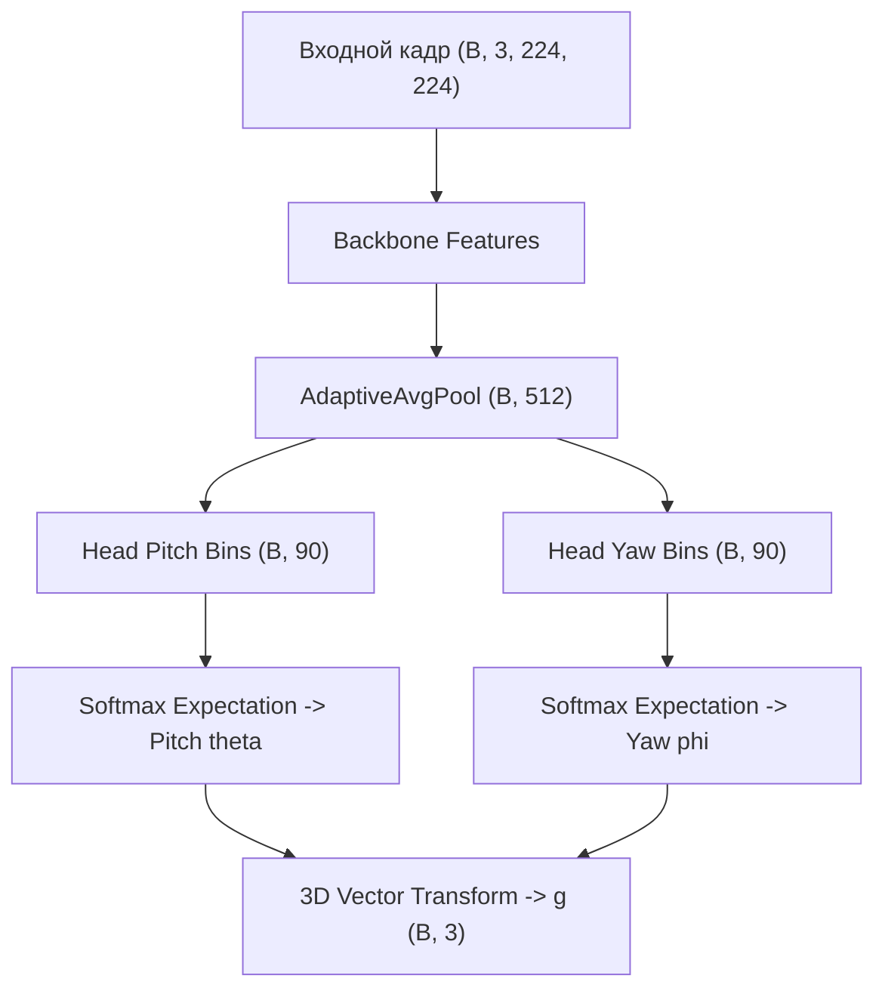

# Автоматический архитектурный отчет: l2cs_gaze_net

## 1. Сводные метрики вычислительной сложности

| Метрика | Значение | Описание |
| :--- | :--- | :--- |
| **Архитектура** | `l2cs_gaze_net` | Идентификатор архитектуры |
| **Бэкбон** | `resnet18` | Сверточный экстрактор признаков |
| **Число бинов (K)** | `90` | Дискретизация углового пространства |
| **Всего параметров** | `11,551,350` | Суммарное число параметров |
| **Обучаемые параметры** | `11,551,350` | Параметры с градиентом |
| **Объем весов в памяти** | `44.102 MB` | Память в формате float32 |
| **Вычислительная сложность** | `18.1394 GFLOPs` | Число операций с плавающей точкой |
| **Средняя задержка (Mean)** | `6.636 ms` | Устройство: `cuda:0` |
| **95-й перцентиль задержки (P95)** | `10.055 ms` | Гарантированное время кадра |
| **Пропускная способность** | `150.7 FPS` | Кадров в секунду |

## 2. Математическая декомпозиция слоев

1. **Извлечение признаков:** $\mathbf{F} = \operatorname{Backbone}(\mathbf{I}) \in \mathbb{R}^{C \times H \times W}$.
2. **Глобальное усреднение:** $\mathbf{f} = \operatorname{AdaptiveAvgPool}(\mathbf{F}) \in \mathbb{R}^{D}$, где $D = 512$.
3. **Классификационные логиты тангажа и рыскания:**
   $$\mathbf{z}_{\theta} = \mathbf{W}_{\theta} \mathbf{f} + \mathbf{b}_{\theta} \in \mathbb{R}^K, \quad \mathbf{z}_{\phi} = \mathbf{W}_{\phi} \mathbf{f} + \mathbf{b}_{\phi} \in \mathbb{R}^K$$
4. **Распределение вероятностей (Softmax):**
   $$p_k = \frac{\exp(z_k)}{\sum_{j=1}^K \exp(z_j)}, \quad k \in \{1, \dots, K\}.$$
5. **Математическое ожидание углов (Регрессия):**
   $$\hat{\theta} = \sum_{k=1}^K p_k^\theta c_k, \quad \hat{\phi} = \sum_{k=1}^K p_k^\phi c_k.$$
6. **Единичный 3D-вектор направления взгляда:**
   $$\hat{\mathbf{g}} = \begin{bmatrix} -\cos\hat{\theta}\sin\hat{\phi} \\ -\sin\hat{\theta} \\ -\cos\hat{\theta}\cos\hat{\phi} \end{bmatrix}, \quad \|\hat{\mathbf{g}}\|_2 = 1.$$

## 3. Граф вычислительного конвейера (Mermaid)

## 4. Послойный профиль архитектуры

| Слой | Тип | Размерность входа | Размерность выхода | Параметры | FLOPs |
| :--- | :--- | :--- | :--- | :--- | :--- |
| `feature_extractor.0` | `Conv2d` | `[1, 3, 224, 224]` | `[1, 64, 112, 112]` | 9,408 | 236,027,904 |
| `feature_extractor.1` | `BatchNorm2d` | `[1, 64, 112, 112]` | `[1, 64, 112, 112]` | 128 | 0 |
| `feature_extractor.2` | `ReLU` | `[1, 64, 112, 112]` | `[1, 64, 112, 112]` | 0 | 0 |
| `feature_extractor.3` | `MaxPool2d` | `[1, 64, 112, 112]` | `[1, 64, 56, 56]` | 0 | 0 |
| `feature_extractor.4.0.conv1` | `Conv2d` | `[1, 64, 56, 56]` | `[1, 64, 56, 56]` | 36,864 | 231,211,008 |
| `feature_extractor.4.0.bn1` | `BatchNorm2d` | `[1, 64, 56, 56]` | `[1, 64, 56, 56]` | 128 | 0 |
| `feature_extractor.4.0.relu` | `ReLU` | `[1, 64, 56, 56]` | `[1, 64, 56, 56]` | 0 | 0 |
| `feature_extractor.4.0.conv2` | `Conv2d` | `[1, 64, 56, 56]` | `[1, 64, 56, 56]` | 36,864 | 231,211,008 |
| `feature_extractor.4.0.bn2` | `BatchNorm2d` | `[1, 64, 56, 56]` | `[1, 64, 56, 56]` | 128 | 0 |
| `feature_extractor.4.0.relu` | `ReLU` | `[1, 64, 56, 56]` | `[1, 64, 56, 56]` | 0 | 0 |
| `feature_extractor.4.1.conv1` | `Conv2d` | `[1, 64, 56, 56]` | `[1, 64, 56, 56]` | 36,864 | 231,211,008 |
| `feature_extractor.4.1.bn1` | `BatchNorm2d` | `[1, 64, 56, 56]` | `[1, 64, 56, 56]` | 128 | 0 |
| `feature_extractor.4.1.relu` | `ReLU` | `[1, 64, 56, 56]` | `[1, 64, 56, 56]` | 0 | 0 |
| `feature_extractor.4.1.conv2` | `Conv2d` | `[1, 64, 56, 56]` | `[1, 64, 56, 56]` | 36,864 | 231,211,008 |
| `feature_extractor.4.1.bn2` | `BatchNorm2d` | `[1, 64, 56, 56]` | `[1, 64, 56, 56]` | 128 | 0 |
| `feature_extractor.4.1.relu` | `ReLU` | `[1, 64, 56, 56]` | `[1, 64, 56, 56]` | 0 | 0 |
| `feature_extractor.5.0.conv1` | `Conv2d` | `[1, 64, 56, 56]` | `[1, 128, 28, 28]` | 73,728 | 115,605,504 |
| `feature_extractor.5.0.bn1` | `BatchNorm2d` | `[1, 128, 28, 28]` | `[1, 128, 28, 28]` | 256 | 0 |
| `feature_extractor.5.0.relu` | `ReLU` | `[1, 128, 28, 28]` | `[1, 128, 28, 28]` | 0 | 0 |
| `feature_extractor.5.0.conv2` | `Conv2d` | `[1, 128, 28, 28]` | `[1, 128, 28, 28]` | 147,456 | 231,211,008 |
| `feature_extractor.5.0.bn2` | `BatchNorm2d` | `[1, 128, 28, 28]` | `[1, 128, 28, 28]` | 256 | 0 |
| `feature_extractor.5.0.downsample.0` | `Conv2d` | `[1, 64, 56, 56]` | `[1, 128, 28, 28]` | 8,192 | 12,845,056 |
| `feature_extractor.5.0.downsample.1` | `BatchNorm2d` | `[1, 128, 28, 28]` | `[1, 128, 28, 28]` | 256 | 0 |
| `feature_extractor.5.0.relu` | `ReLU` | `[1, 128, 28, 28]` | `[1, 128, 28, 28]` | 0 | 0 |
| `feature_extractor.5.1.conv1` | `Conv2d` | `[1, 128, 28, 28]` | `[1, 128, 28, 28]` | 147,456 | 231,211,008 |
| `feature_extractor.5.1.bn1` | `BatchNorm2d` | `[1, 128, 28, 28]` | `[1, 128, 28, 28]` | 256 | 0 |
| `feature_extractor.5.1.relu` | `ReLU` | `[1, 128, 28, 28]` | `[1, 128, 28, 28]` | 0 | 0 |
| `feature_extractor.5.1.conv2` | `Conv2d` | `[1, 128, 28, 28]` | `[1, 128, 28, 28]` | 147,456 | 231,211,008 |
| `feature_extractor.5.1.bn2` | `BatchNorm2d` | `[1, 128, 28, 28]` | `[1, 128, 28, 28]` | 256 | 0 |
| `feature_extractor.5.1.relu` | `ReLU` | `[1, 128, 28, 28]` | `[1, 128, 28, 28]` | 0 | 0 |
| `feature_extractor.6.0.conv1` | `Conv2d` | `[1, 128, 28, 28]` | `[1, 256, 14, 14]` | 294,912 | 115,605,504 |
| `feature_extractor.6.0.bn1` | `BatchNorm2d` | `[1, 256, 14, 14]` | `[1, 256, 14, 14]` | 512 | 0 |
| `feature_extractor.6.0.relu` | `ReLU` | `[1, 256, 14, 14]` | `[1, 256, 14, 14]` | 0 | 0 |
| `feature_extractor.6.0.conv2` | `Conv2d` | `[1, 256, 14, 14]` | `[1, 256, 14, 14]` | 589,824 | 231,211,008 |
| `feature_extractor.6.0.bn2` | `BatchNorm2d` | `[1, 256, 14, 14]` | `[1, 256, 14, 14]` | 512 | 0 |
| ... | ... | ... | ... | ... | (Всего слоев: 350) |