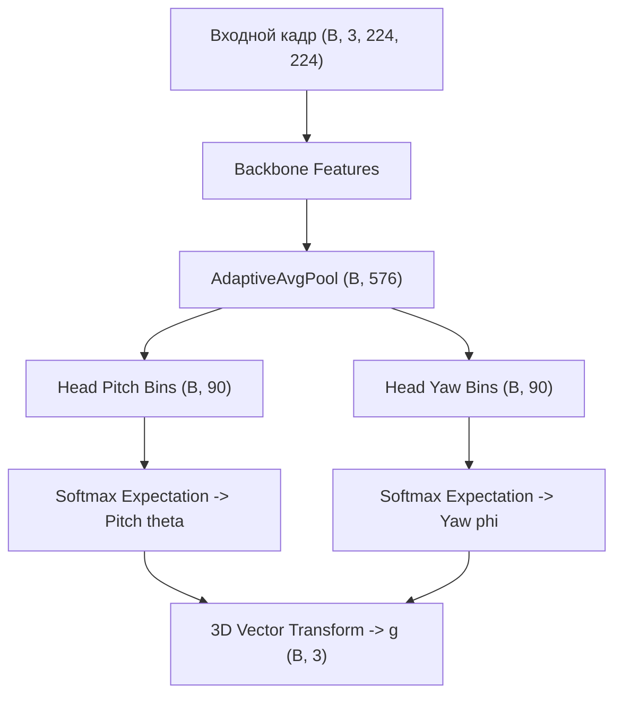

# Автоматический архитектурный отчет: l2cs_gaze_net

## 1. Сводные метрики вычислительной сложности

| Метрика | Значение | Описание |
| :--- | :--- | :--- |
| **Архитектура** | `l2cs_gaze_net` | Идентификатор архитектуры |
| **Бэкбон** | `mobilenet_v3_small` | Сверточный экстрактор признаков |
| **Число бинов (K)** | `90` | Дискретизация углового пространства |
| **Всего параметров** | `1,342,806` | Суммарное число параметров |
| **Обучаемые параметры** | `1,342,806` | Параметры с градиентом |
| **Объем весов в памяти** | `5.169 MB` | Память в формате float32 |
| **Вычислительная сложность** | `0.5531 GFLOPs` | Число операций с плавающей точкой |
| **Средняя задержка (Mean)** | `13.431 ms` | Устройство: `cuda:0` |
| **95-й перцентиль задержки (P95)** | `17.977 ms` | Гарантированное время кадра |
| **Пропускная способность** | `74.5 FPS` | Кадров в секунду |

## 2. Математическая декомпозиция слоев

1. **Извлечение признаков:** $\mathbf{F} = \operatorname{Backbone}(\mathbf{I}) \in \mathbb{R}^{C \times H \times W}$.
2. **Глобальное усреднение:** $\mathbf{f} = \operatorname{AdaptiveAvgPool}(\mathbf{F}) \in \mathbb{R}^{D}$, где $D = 576$.
3. **Классификационные логиты тангажа и рыскания:**
   $$\mathbf{z}_{\theta} = \mathbf{W}_{\theta} \mathbf{f} + \mathbf{b}_{\theta} \in \mathbb{R}^K, \quad \mathbf{z}_{\phi} = \mathbf{W}_{\phi} \mathbf{f} + \mathbf{b}_{\phi} \in \mathbb{R}^K$$
4. **Распределение вероятностей (Softmax):**
   $$p_k = \frac{\exp(z_k)}{\sum_{j=1}^K \exp(z_j)}, \quad k \in \{1, \dots, K\}.$$
5. **Математическое ожидание углов (Регрессия):**
   $$\hat{\theta} = \sum_{k=1}^K p_k^\theta c_k, \quad \hat{\phi} = \sum_{k=1}^K p_k^\phi c_k.$$
6. **Единичный 3D-вектор направления взгляда:**
   $$\hat{\mathbf{g}} = \begin{bmatrix} -\cos\hat{\theta}\sin\hat{\phi} \\ -\sin\hat{\theta} \\ -\cos\hat{\theta}\cos\hat{\phi} \end{bmatrix}, \quad \|\hat{\mathbf{g}}\|_2 = 1.$$

## 3. Граф вычислительного конвейера (Mermaid)

## 4. Послойный профиль архитектуры

| Слой | Тип | Размерность входа | Размерность выхода | Параметры | FLOPs |
| :--- | :--- | :--- | :--- | :--- | :--- |
| `feature_extractor.0.0` | `Conv2d` | `[1, 3, 224, 224]` | `[1, 16, 112, 112]` | 432 | 10,838,016 |
| `feature_extractor.0.1` | `BatchNorm2d` | `[1, 16, 112, 112]` | `[1, 16, 112, 112]` | 32 | 0 |
| `feature_extractor.0.2` | `Hardswish` | `[1, 16, 112, 112]` | `[1, 16, 112, 112]` | 0 | 0 |
| `feature_extractor.1.block.0.0` | `Conv2d` | `[1, 16, 112, 112]` | `[1, 16, 56, 56]` | 144 | 903,168 |
| `feature_extractor.1.block.0.1` | `BatchNorm2d` | `[1, 16, 56, 56]` | `[1, 16, 56, 56]` | 32 | 0 |
| `feature_extractor.1.block.0.2` | `ReLU` | `[1, 16, 56, 56]` | `[1, 16, 56, 56]` | 0 | 0 |
| `feature_extractor.1.block.1.avgpool` | `AdaptiveAvgPool2d` | `[1, 16, 56, 56]` | `[1, 16, 1, 1]` | 0 | 0 |
| `feature_extractor.1.block.1.fc1` | `Conv2d` | `[1, 16, 1, 1]` | `[1, 8, 1, 1]` | 136 | 256 |
| `feature_extractor.1.block.1.activation` | `ReLU` | `[1, 8, 1, 1]` | `[1, 8, 1, 1]` | 0 | 0 |
| `feature_extractor.1.block.1.fc2` | `Conv2d` | `[1, 8, 1, 1]` | `[1, 16, 1, 1]` | 144 | 256 |
| `feature_extractor.1.block.1.scale_activation` | `Hardsigmoid` | `[1, 16, 1, 1]` | `[1, 16, 1, 1]` | 0 | 0 |
| `feature_extractor.1.block.2.0` | `Conv2d` | `[1, 16, 56, 56]` | `[1, 16, 56, 56]` | 256 | 1,605,632 |
| `feature_extractor.1.block.2.1` | `BatchNorm2d` | `[1, 16, 56, 56]` | `[1, 16, 56, 56]` | 32 | 0 |
| `feature_extractor.2.block.0.0` | `Conv2d` | `[1, 16, 56, 56]` | `[1, 72, 56, 56]` | 1,152 | 7,225,344 |
| `feature_extractor.2.block.0.1` | `BatchNorm2d` | `[1, 72, 56, 56]` | `[1, 72, 56, 56]` | 144 | 0 |
| `feature_extractor.2.block.0.2` | `ReLU` | `[1, 72, 56, 56]` | `[1, 72, 56, 56]` | 0 | 0 |
| `feature_extractor.2.block.1.0` | `Conv2d` | `[1, 72, 56, 56]` | `[1, 72, 28, 28]` | 648 | 1,016,064 |
| `feature_extractor.2.block.1.1` | `BatchNorm2d` | `[1, 72, 28, 28]` | `[1, 72, 28, 28]` | 144 | 0 |
| `feature_extractor.2.block.1.2` | `ReLU` | `[1, 72, 28, 28]` | `[1, 72, 28, 28]` | 0 | 0 |
| `feature_extractor.2.block.2.0` | `Conv2d` | `[1, 72, 28, 28]` | `[1, 24, 28, 28]` | 1,728 | 2,709,504 |
| `feature_extractor.2.block.2.1` | `BatchNorm2d` | `[1, 24, 28, 28]` | `[1, 24, 28, 28]` | 48 | 0 |
| `feature_extractor.3.block.0.0` | `Conv2d` | `[1, 24, 28, 28]` | `[1, 88, 28, 28]` | 2,112 | 3,311,616 |
| `feature_extractor.3.block.0.1` | `BatchNorm2d` | `[1, 88, 28, 28]` | `[1, 88, 28, 28]` | 176 | 0 |
| `feature_extractor.3.block.0.2` | `ReLU` | `[1, 88, 28, 28]` | `[1, 88, 28, 28]` | 0 | 0 |
| `feature_extractor.3.block.1.0` | `Conv2d` | `[1, 88, 28, 28]` | `[1, 88, 28, 28]` | 792 | 1,241,856 |
| `feature_extractor.3.block.1.1` | `BatchNorm2d` | `[1, 88, 28, 28]` | `[1, 88, 28, 28]` | 176 | 0 |
| `feature_extractor.3.block.1.2` | `ReLU` | `[1, 88, 28, 28]` | `[1, 88, 28, 28]` | 0 | 0 |
| `feature_extractor.3.block.2.0` | `Conv2d` | `[1, 88, 28, 28]` | `[1, 24, 28, 28]` | 2,112 | 3,311,616 |
| `feature_extractor.3.block.2.1` | `BatchNorm2d` | `[1, 24, 28, 28]` | `[1, 24, 28, 28]` | 48 | 0 |
| `feature_extractor.4.block.0.0` | `Conv2d` | `[1, 24, 28, 28]` | `[1, 96, 28, 28]` | 2,304 | 3,612,672 |
| `feature_extractor.4.block.0.1` | `BatchNorm2d` | `[1, 96, 28, 28]` | `[1, 96, 28, 28]` | 192 | 0 |
| `feature_extractor.4.block.0.2` | `Hardswish` | `[1, 96, 28, 28]` | `[1, 96, 28, 28]` | 0 | 0 |
| `feature_extractor.4.block.1.0` | `Conv2d` | `[1, 96, 28, 28]` | `[1, 96, 14, 14]` | 2,400 | 940,800 |
| `feature_extractor.4.block.1.1` | `BatchNorm2d` | `[1, 96, 14, 14]` | `[1, 96, 14, 14]` | 192 | 0 |
| `feature_extractor.4.block.1.2` | `Hardswish` | `[1, 96, 14, 14]` | `[1, 96, 14, 14]` | 0 | 0 |
| ... | ... | ... | ... | ... | (Всего слоев: 740) |