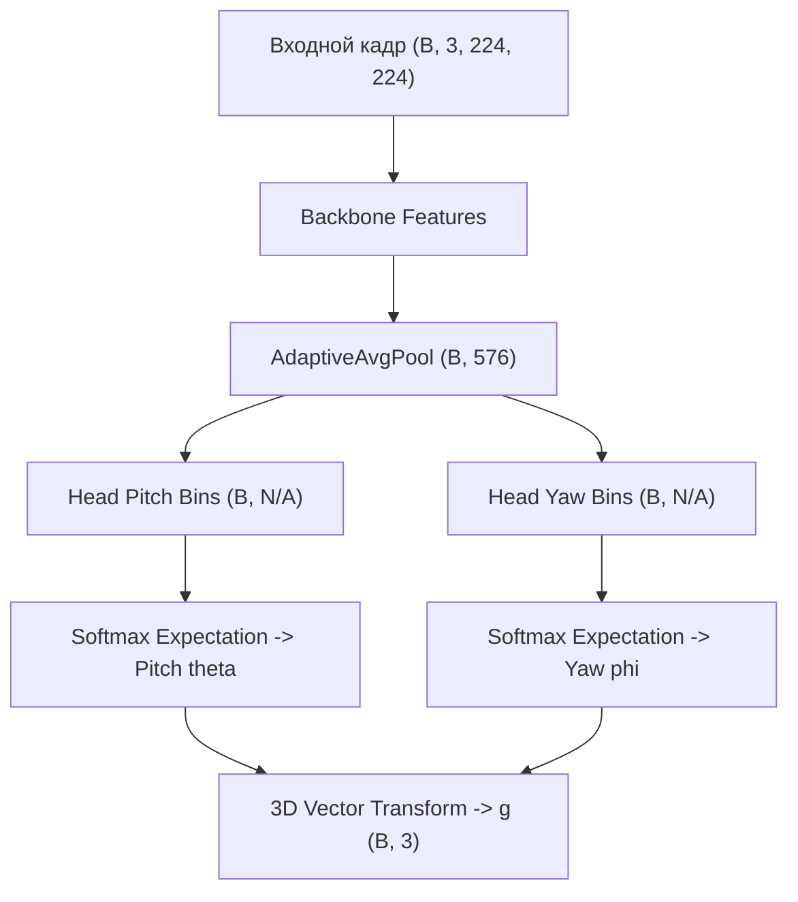

# Автоматический архитектурный отчет: yolo26n_gaze_net

## 1. Сводные метрики вычислительной сложности

| Метрика | Значение | Описание |
| :--- | :--- | :--- |
| **Архитектура** | `yolo26n_gaze_net` | Идентификатор архитектуры |
| **Бэкбон** | `yolo26n` | Сверточный экстрактор признаков |
| **Число бинов (K)** | `N/A` | Дискретизация углового пространства |
| **Всего параметров** | `1,487,464` | Суммарное число параметров |
| **Обучаемые параметры** | `1,487,464` | Параметры с градиентом |
| **Объем весов в памяти** | `5.718 MB` | Память в формате float32 |
| **Вычислительная сложность** | `2.1225 GFLOPs` | Число операций с плавающей точкой |
| **Средняя задержка (Mean)** | `19.404 ms` | Устройство: `cuda:0` |
| **95-й перцентиль задержки (P95)** | `20.681 ms` | Гарантированное время кадра |
| **Пропускная способность** | `51.5 FPS` | Кадров в секунду |

## 2. Математическая декомпозиция слоев

1. **Извлечение признаков:** $\mathbf{F} = \operatorname{Backbone}(\mathbf{I}) \in \mathbb{R}^{C \times H \times W}$.
2. **Глобальное усреднение:** $\mathbf{f} = \operatorname{AdaptiveAvgPool}(\mathbf{F}) \in \mathbb{R}^{D}$, где $D = 576$.
3. **Классификационные логиты тангажа и рыскания:**
   $$\mathbf{z}_{\theta} = \mathbf{W}_{\theta} \mathbf{f} + \mathbf{b}_{\theta} \in \mathbb{R}^K, \quad \mathbf{z}_{\phi} = \mathbf{W}_{\phi} \mathbf{f} + \mathbf{b}_{\phi} \in \mathbb{R}^K$$
4. **Распределение вероятностей (Softmax):**
   $$p_k = \frac{\exp(z_k)}{\sum_{j=1}^K \exp(z_j)}, \quad k \in \{1, \dots, K\}.$$
5. **Математическое ожидание углов (Регрессия):**
   $$\hat{\theta} = \sum_{k=1}^K p_k^\theta c_k, \quad \hat{\phi} = \sum_{k=1}^K p_k^\phi c_k.$$
6. **Единичный 3D-вектор направления взгляда:**
   $$\hat{\mathbf{g}} = \begin{bmatrix} -\cos\hat{\theta}\sin\hat{\phi} \\ -\sin\hat{\theta} \\ -\cos\hat{\theta}\cos\hat{\phi} \end{bmatrix}, \quad \|\hat{\mathbf{g}}\|_2 = 1.$$

## 3. Граф вычислительного конвейера (Mermaid)

## 4. Послойный профиль архитектуры

| Слой | Тип | Размерность входа | Размерность выхода | Параметры | FLOPs |
| :--- | :--- | :--- | :--- | :--- | :--- |
| `backbone_layers.0.conv` | `Conv2d` | `[1, 3, 224, 224]` | `[1, 16, 112, 112]` | 432 | 10,838,016 |
| `backbone_layers.0.bn` | `BatchNorm2d` | `[1, 16, 112, 112]` | `[1, 16, 112, 112]` | 32 | 0 |
| `backbone_layers.0.act` | `SiLU` | `[1, 16, 112, 112]` | `[1, 16, 112, 112]` | 0 | 0 |
| `backbone_layers.1.conv` | `Conv2d` | `[1, 16, 112, 112]` | `[1, 32, 56, 56]` | 4,608 | 28,901,376 |
| `backbone_layers.1.bn` | `BatchNorm2d` | `[1, 32, 56, 56]` | `[1, 32, 56, 56]` | 64 | 0 |
| `backbone_layers.0.act` | `SiLU` | `[1, 32, 56, 56]` | `[1, 32, 56, 56]` | 0 | 0 |
| `backbone_layers.2.cv1.conv` | `Conv2d` | `[1, 32, 56, 56]` | `[1, 32, 56, 56]` | 1,024 | 6,422,528 |
| `backbone_layers.2.cv1.bn` | `BatchNorm2d` | `[1, 32, 56, 56]` | `[1, 32, 56, 56]` | 64 | 0 |
| `backbone_layers.0.act` | `SiLU` | `[1, 32, 56, 56]` | `[1, 32, 56, 56]` | 0 | 0 |
| `backbone_layers.2.m.0.cv1.conv` | `Conv2d` | `[1, 16, 56, 56]` | `[1, 8, 56, 56]` | 1,152 | 7,225,344 |
| `backbone_layers.2.m.0.cv1.bn` | `BatchNorm2d` | `[1, 8, 56, 56]` | `[1, 8, 56, 56]` | 16 | 0 |
| `backbone_layers.0.act` | `SiLU` | `[1, 8, 56, 56]` | `[1, 8, 56, 56]` | 0 | 0 |
| `backbone_layers.2.m.0.cv2.conv` | `Conv2d` | `[1, 8, 56, 56]` | `[1, 16, 56, 56]` | 1,152 | 7,225,344 |
| `backbone_layers.2.m.0.cv2.bn` | `BatchNorm2d` | `[1, 16, 56, 56]` | `[1, 16, 56, 56]` | 32 | 0 |
| `backbone_layers.0.act` | `SiLU` | `[1, 16, 56, 56]` | `[1, 16, 56, 56]` | 0 | 0 |
| `backbone_layers.2.cv2.conv` | `Conv2d` | `[1, 48, 56, 56]` | `[1, 64, 56, 56]` | 3,072 | 19,267,584 |
| `backbone_layers.2.cv2.bn` | `BatchNorm2d` | `[1, 64, 56, 56]` | `[1, 64, 56, 56]` | 128 | 0 |
| `backbone_layers.0.act` | `SiLU` | `[1, 64, 56, 56]` | `[1, 64, 56, 56]` | 0 | 0 |
| `backbone_layers.3.conv` | `Conv2d` | `[1, 64, 56, 56]` | `[1, 64, 28, 28]` | 36,864 | 57,802,752 |
| `backbone_layers.3.bn` | `BatchNorm2d` | `[1, 64, 28, 28]` | `[1, 64, 28, 28]` | 128 | 0 |
| `backbone_layers.0.act` | `SiLU` | `[1, 64, 28, 28]` | `[1, 64, 28, 28]` | 0 | 0 |
| `backbone_layers.4.cv1.conv` | `Conv2d` | `[1, 64, 28, 28]` | `[1, 64, 28, 28]` | 4,096 | 6,422,528 |
| `backbone_layers.4.cv1.bn` | `BatchNorm2d` | `[1, 64, 28, 28]` | `[1, 64, 28, 28]` | 128 | 0 |
| `backbone_layers.0.act` | `SiLU` | `[1, 64, 28, 28]` | `[1, 64, 28, 28]` | 0 | 0 |
| `backbone_layers.4.m.0.cv1.conv` | `Conv2d` | `[1, 32, 28, 28]` | `[1, 16, 28, 28]` | 4,608 | 7,225,344 |
| `backbone_layers.4.m.0.cv1.bn` | `BatchNorm2d` | `[1, 16, 28, 28]` | `[1, 16, 28, 28]` | 32 | 0 |
| `backbone_layers.0.act` | `SiLU` | `[1, 16, 28, 28]` | `[1, 16, 28, 28]` | 0 | 0 |
| `backbone_layers.4.m.0.cv2.conv` | `Conv2d` | `[1, 16, 28, 28]` | `[1, 32, 28, 28]` | 4,608 | 7,225,344 |
| `backbone_layers.4.m.0.cv2.bn` | `BatchNorm2d` | `[1, 32, 28, 28]` | `[1, 32, 28, 28]` | 64 | 0 |
| `backbone_layers.0.act` | `SiLU` | `[1, 32, 28, 28]` | `[1, 32, 28, 28]` | 0 | 0 |
| `backbone_layers.4.cv2.conv` | `Conv2d` | `[1, 96, 28, 28]` | `[1, 128, 28, 28]` | 12,288 | 19,267,584 |
| `backbone_layers.4.cv2.bn` | `BatchNorm2d` | `[1, 128, 28, 28]` | `[1, 128, 28, 28]` | 256 | 0 |
| `backbone_layers.0.act` | `SiLU` | `[1, 128, 28, 28]` | `[1, 128, 28, 28]` | 0 | 0 |
| `backbone_layers.5.conv` | `Conv2d` | `[1, 128, 28, 28]` | `[1, 128, 14, 14]` | 147,456 | 57,802,752 |
| `backbone_layers.5.bn` | `BatchNorm2d` | `[1, 128, 14, 14]` | `[1, 128, 14, 14]` | 256 | 0 |
| ... | ... | ... | ... | ... | (Всего слоев: 685) |